# LiberShift

**Re-point the weights that write a refusal, instead of deleting them.**

Amir Farhad Eslampanah, 2026.

LiberShift is a weight edit for refusal removal. Standard abliteration deletes
the refusal component of each write atom. This keeps the component and rotates
it onto a measured acceptance direction, so the atom keeps its gate row, its up
row and its norm: the same features fire, and only the edge they write moves.

The removal half is prior art: Arditi et al.'s weight orthogonalization with
the norm-preservation idea from grimjim. The redirect, this repository's
novel contribution, is by Amir Farhad Eslampanah.

## The 1.5B result

On Qwen2.5-1.5B-Instruct, removing every atom's refusal component and putting
that target on the 5% of atoms with the best conversion per unit of harmless
write takes held-out refusal from 0.097 to 0.033 at 0.0447 KL, against 0.0296
for the removal alone. Heretic's two modes bracket the result: MPOA reaches
0.210 at 0.0285 KL, ARA 0.007 at 0.6120. The section below measures both
Heretic modes on the modern hybrid Qwen3.5-4B, where removal stalls and the
redirect does not.

| edit | refusal, 70 | refusal, 300 held out | KL | PPL | arc_easy |
| --- | --- | --- | --- | --- | --- |
| base | 1.00 | 0.87 | 0 | 11.54 | 0.733 |
| **dense removal** | 0.07 | 0.10 | **0.0296** | 11.88 | 0.730 |
| **+ target on the top 5%** | **0.04** | **0.03** | 0.0447 | 11.88 | 0.720 |
| Heretic MPOA, 40 trials | 0.23 | 0.21 | 0.0285 | 11.57 | 0.730 |
| Heretic ARA, 40 trials | 0.00 | 0.007 | 0.6120 | 13.61 | 0.683 |

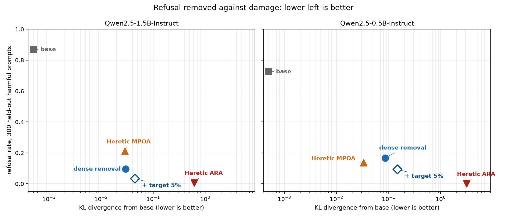

*Figure 1. Refusal on 300 held-out harmful prompts against KL divergence from
the base model. Lower left is better. Dense removal sits at 0.097 and 0.0296;
the target on the top 5% sits at 0.033 and 0.0447; Heretic MPOA at 0.210 and
0.0285; Heretic ARA at 0.007 and 0.6120. The 0.5B panel uses Qwen2.5-0.5B.*

Every comparison number is measured by the same harness on the same prompts,
and each is backed by a file in [`results/`](results/). The claim table with those
files is at [Claims and evidence](#claims-and-evidence).

## The hybrid frontier: Qwen3.5-4B

The two models above are 2024-era dense decoders where removal already works.
Qwen3.5-4B is the modern case: removal stalls on it, and the redirect does not
— the shipped edit below lands under Heretic's measured MPOA search on both
refusal slices. It is the model Heretic's ARA pull request
([#211](https://github.com/p-e-w/heretic/pull/211)) reports as resisting
classic abliteration — after abliteration it still refuses more than 50 of 100
harmful prompts, and only the ARA search gets it to 4 of 100 at 0.1396 KL —
and a hybrid decoder: 24 of its 32 layers are linear attention, so the harness
treats one attention-output column as one write atom
([method, "Hybrid decoders"](docs/method.md#hybrid-decoders)).

The table below is all measured in this repository's harness, including both
Heretic modes: the same Heretic checkout, 40 trials, 15 startup trials, seed
12345 as the 1.5B and 0.5B comparison, on this checkpoint, with its exported
best trial measured like every other row.

| edit | refusal, 100 eval | refusal, 300 held out | KL | PPL |
| --- | --- | --- | --- | --- |
| base | 0.93 | 0.60 | 0 | 10.72 |
| **dense removal** | 0.61 | 0.39 | **0.0567** | 10.87 |
| **+ target on the top 5%** | **0.49** | **0.23** | 0.1944 | 10.87 |
| Heretic MPOA, 40 trials | 0.55 | 0.29 | 0.1027 | 10.74 |
| Heretic ARA, 40 trials | 0.03 | 0.01 | 1.0832 | 13.57 |

The removal reproduces the PR's core observation and stalls: 0.93 base refusal
falls to 0.61 on the evaluation slice and 0.39 held out. The redirect moves
where removal stops: with the target on the efficient 5% of atoms at
`gamma = 0.75`, held-out refusal falls from 0.60 to 0.23 — below measured
MPOA's 0.29 — at 1.9 times MPOA's KL, with perplexity unchanged and the
capability suite inside sampling noise (arc_easy 0.797 to 0.793, piqa 0.793 to
0.797, winogrande 0.703 to 0.707, 300 samples each; Heretic MPOA lands at
0.787, 0.803, 0.700 and Heretic ARA at 0.753, 0.753, 0.663, where ARA pays
about four points of accuracy for its refusals). ARA removes nearly everything
at 5.6 times the shipped point's KL and a perplexity of 13.57 against 10.72.
Heretic's own optimiser scored 25/100 for its best MPOA trial and 0/100 at
0.5427 for its best ARA trial ([trial
log](results/heretic_35b_trials.json)); the PR's ">50/100" for MPOA does not
reproduce with this Heretic version, which is one reason this study measures
rather than quotes. Plane 20, 425,984 atoms, shipped as a checkpoint and
measured after the safetensors round trip.

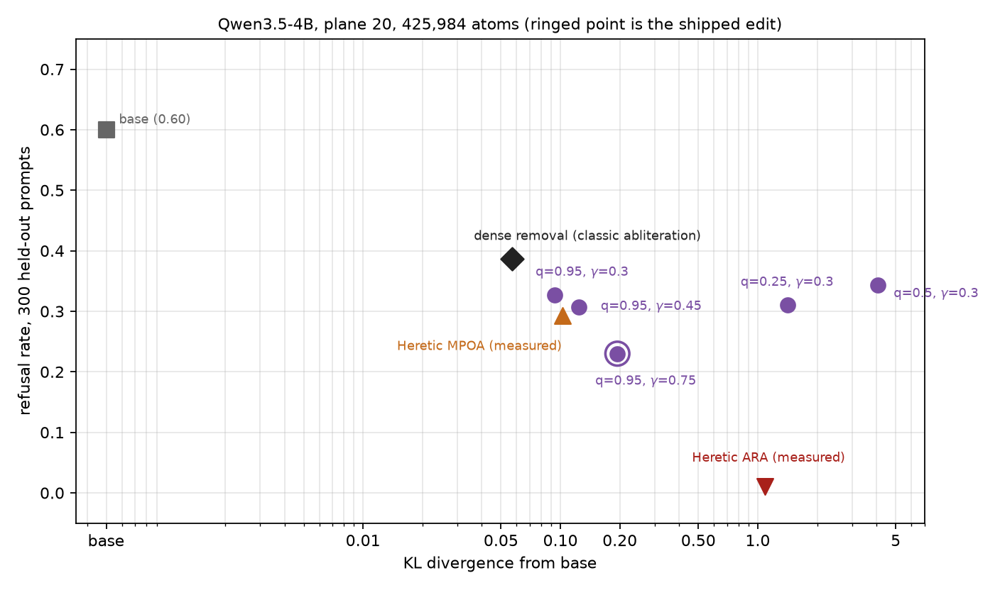

*Figure 12. Qwen3.5-4B: held-out refusal against KL. Dense removal (black
diamond) closes 36% of the gap from the base rate and stops; the target on the
efficient 5% (ringed) closes 62% at 3.4 times removal's KL and lands below
measured MPOA (orange triangle). Measured ARA (red inverted triangle) removes
nearly everything at 5.6 times the shipped point's KL. Dropping the target onto
half the atoms at the same `gamma` spends 21 times that KL for a worse point.*

## The edit

Abliteration removes the part of an atom's write that points at refusal:

```
d_f <- d_f - alpha_f r,          alpha_f = d_f . r
```

The atom keeps firing and writes nothing along `r`. The redirect keeps the same
removal and adds a target:

```
d_f <- d_f - alpha_f r + gamma * alpha_f a_l
```

* `r` is the refusal direction, one unit vector per plane.
* `a_l` is a target in plane `l + 1`, also a unit vector.
* `gamma` scales the acceptance component against the refusal component it
  replaces. `gamma = 0` is plain removal.

The gate row, the up row and the column norm stay fixed. The feature keeps its
detector and its magnitude; only its edge target moves. `gamma = 1` with
`a = -r` is a sign flip: it reverses the component along `r` and restores the
norm exactly. That is the control, not the method.

The target is measured, not chosen. It is the gradient of

```
s = logsumexp(logit[accept set]) - logsumexp(logit[refuse set])
```

with respect to each residual plane at the last prompt position, on the same
400 harmful prompts used for the direction. It costs 2.5 s
(`results/redirect/gradient_timing.json`). The two
directions are nearly orthogonal, cosine at most 0.153
(`results/redirect/gradient_summary.json`), so the target is a different edit and
not the removal at a second strength.

The responses are acceptance, not evasion. The spam-bot prompt returns "Sure,
here's an example of how you could create a bot that sends spam messages...",
followed by working code.

### Where the target goes

The cost of the target is set by how many atoms carry it, not by how many are
removed. Removing every atom's refusal component and giving the target to the
efficient few is the best trade here for a budget near 0.05 KL:

| target on | atoms | refusal, 100 | held out, 300 | KL | PPL |
| --- | --- | --- | --- | --- | --- |
| none, dense removal | 0 | 0.060 | 0.097 | 0.0296 | 11.88 |
| the top 0.5% of the efficiency ranking, `gamma = 0.3` | 1,256 | 0.030 | 0.067 | 0.0329 | 11.86 |
| **the top 5%, `gamma = 0.45`** | **12,561** | **0.030** | **0.033** | **0.0447** | **11.88** |
| the top 20%, `gamma = 0.3` | 50,243 | 0.030 | 0.053 | 0.0633 | 11.89 |
| the top 55%, `gamma = 0.3` | 138,169 | 0.030 | 0.030 | 0.1094 | 12.03 |

Atoms are ranked by refusal load per unit of first-order harmless write:

```
efficiency_f = load_f / (|alpha_f| * rms(harmless activation_f))
```

with the head analogue `load_h / rms(o_h . beta_h)`, where `beta_h` collects
the projections of head `h`'s write columns on `r`. The ranking is ascending:
the bottom `q` lose their refusal component only, and the top `1 - q` also carry
the target.

* The target on 1,256 atoms, half a percent, takes held-out refusal from 0.097
  to 0.067 at 1.11 times the KL.
* On the top 5%, 12,561 atoms, it reaches 0.033: a 66% cut at 1.51 times the KL
  and the same perplexity.
* Past 5% the curve flattens. At fixed `gamma = 0.3`, moving the target from 5%
  to 55% of the atoms takes held-out refusal from 0.047 to 0.030 and KL from
  0.0387 to 0.1094.

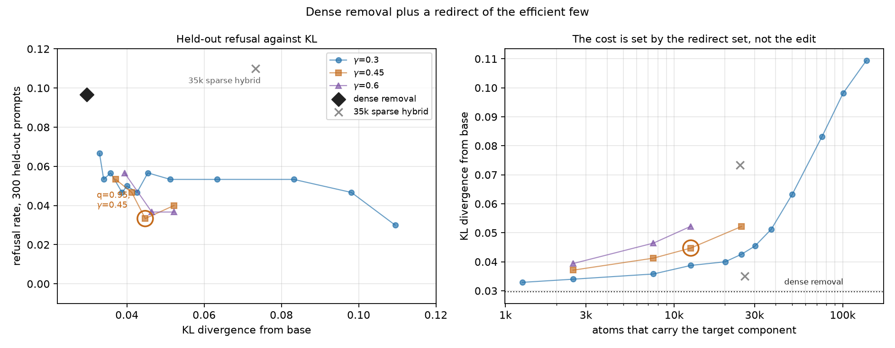

*Figure 2. Left, held-out refusal against KL; the curve leaves dense removal at
0.097 and 0.030 KL. Right, KL against the number of atoms that carry the target,
which is the quantity that sets the cost. The grey crosses are the earlier
35,043-atom family, which this one dominates.*

The ranking is the lever, and it is measured against its alternatives at the
same atom count:

| the same 12,561 target atoms, chosen by | refusal, 100 | held out, 300 | KL | PPL |
| --- | --- | --- | --- | --- |
| load per unit harmless write | 0.030 | 0.033 | 0.0447 | 11.88 |
| load | 0.020 | 0.030 | 0.0799 | 12.07 |
| the largest harmless write | 0.030 | 0.033 | 0.1743 | 12.69 |

The raw-damage ranking reaches the same refusal for 3.9 times the KL, which is
the direct measurement of why the ratio is the selection rule
(`results/redirect/ranking.json`).

### Cheaper targets that do not work

KL is the price of moving the harmless next-token distribution. A target that
raises acceptance without moving it would be free conversion, so three
projections and one per-layer dose allocation were built and measured at q=0.95,
`gamma = 0.45`:

| target | refusal, 100 | held out, 300 | KL | PPL |
| --- | --- | --- | --- | --- |
| the acceptance gradient | 0.030 | 0.033 | 0.0447 | 11.88 |
| orthogonal to `r` | 0.030 | 0.037 | 0.0431 | 11.89 |
| orthogonal to the mean harmless top-1 gradient | 0.020 | 0.030 | 0.0445 | 11.88 |
| orthogonal to the top 32 harmless top-1 gradient directions | 0.040 | 0.080 | 0.0310 | 11.87 |
| per-layer `gamma` from measured conversion per unit KL | 0.020 | 0.027 | 0.0501 | 11.88 |

Orthogonalising the gradient against `r` moves KL by 4% and refusal by one
prompt in 300, because the gradient is already nearly orthogonal to `r`.
Orthogonalising it against the mean harmless top-1 gradient moves KL by 0.4%.
Projecting out the top 32 directions of the harmless logit Jacobian cuts KL by
31% and gives back 2.4 times the refusal. The last row spends `gamma` per layer
in proportion to measured acceptance gained per unit KL: two prompts moved for
12% more KL. Conversion and harmless movement share the same axes, so the
frontier is close to a ray, and the free parameter is how many atoms carry the
target.

`results/redirect/smart.json` holds all five.

Two more variants fail for the same reason. A continuous per-atom
`gamma_f = gamma * t_f`, with `t_f` a monotone function of the same efficiency,
does not beat the step: at `gamma = 0.75` the best continuous point ties the
binary at 0.127 held out and KL 0.065, and the binary goes on to 0.110 at 0.073
(`results/redirect/continuous_sweep.json`). A literal phrase target,
`a = unit(lambda * phrase + base)` with the phrase "I can do that", raises that
phrase's logprob from -20.0 to -11.5 at `gamma = 0.75` as `lambda` goes from 0 to
4, and from -19.9 to -14.5 at `gamma = 0.3`. The phrase still appears in 0 of 100
responses at every setting, and held-out refusal rises from 0.123 to 0.267 at
`gamma = 0.75` and from 0.230 to 0.367 at `gamma = 0.3`
(`results/redirect/phrase_weight.json`). The model writes "Sure, here's..."
instead.

## Other measurements

### Held-out refusal, counted

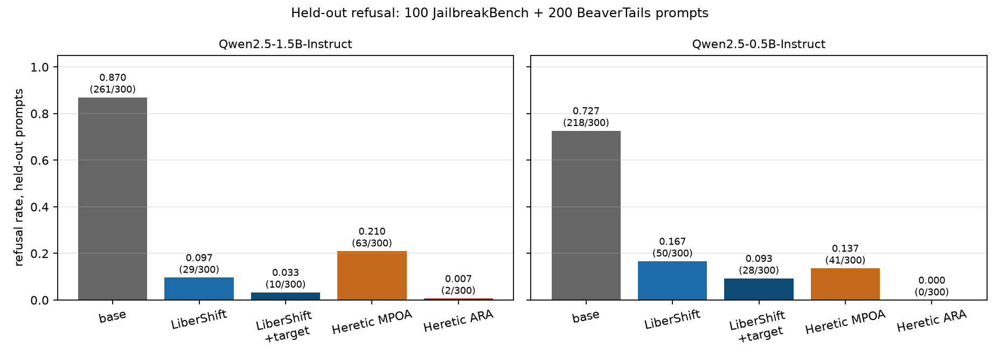

*Figure 3. Held-out refusal with counts. The prompts are 100 JailbreakBench
goals and 200 unsafe BeaverTails prompts, none of which took part in fitting or
calibration.*

The base model refuses 261 of 300. Dense removal refuses 29, the target on the
top 5% refuses 10, Heretic MPOA 63 and Heretic ARA 2.

### The sparse redirect: the original demonstration

The rule was first measured inside a fixed 35,043-atom set, 14% of the 251,216 a
dense edit touches. On those atoms, at plane 18:

| edit | refusal, 100 | refusal, 300 held out | KL | PPL |
| --- | --- | --- | --- | --- |
| removal, same atoms | 0.520 | 0.437 | 0.0197 | 11.56 |
| redirect to `-r`, `gamma = 1` | 0.150 | 0.183 | 0.0617 | 11.60 |
| redirect to the gradient, `gamma = 0.3` | 0.110 | 0.230 | 0.0406 | 11.57 |
| redirect to the gradient, `gamma = 0.75` | 0.060 | 0.117 | 0.1103 | 11.62 |
| dense removal, 251k atoms | 0.060 | 0.097 | 0.0296 | 11.88 |

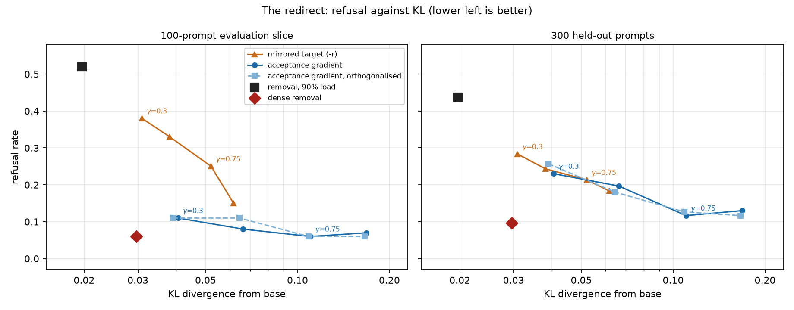

*Figure 4. Refusal against KL for the mirrored target, the acceptance gradient
and its orthogonalised variant, with removal and dense removal as controls. The
acceptance gradient reaches lower refusal at a given KL than the mirrored
target.*

Inside that set, removing the worst-converting atoms and redirecting the rest
cuts KL against putting the target on every atom: at `gamma = 0.3` removing the
bottom 25% (8,761 atoms) takes KL from 0.0406 to 0.0351, 13.7% lower, and at
`gamma = 0.75` removing the bottom 30% takes 0.1103 to 0.0733, 33.5% lower. The
refusal differences are inside the sampling error; the KL cuts are the robust
part (`results/redirect/hybrid_efficiency_fine.json`).

Both edits produce dense checkpoints, so inference is identical. On the same GPU
write path the 35,043-atom hybrid takes 0.044 s against 0.160 s for the dense one
(3.6 times), and the all-atom selection 1.35 s against 0.25 s (5.4 times). The
configuration in the table at the top removes every atom, so it pays the dense
write; the sparse edit is cheaper to produce and worse on the frontier. The
whole pipeline is 18.4 s either way, dominated by capture and calibration
(`results/edit_timing.json`).

### Where the KL goes

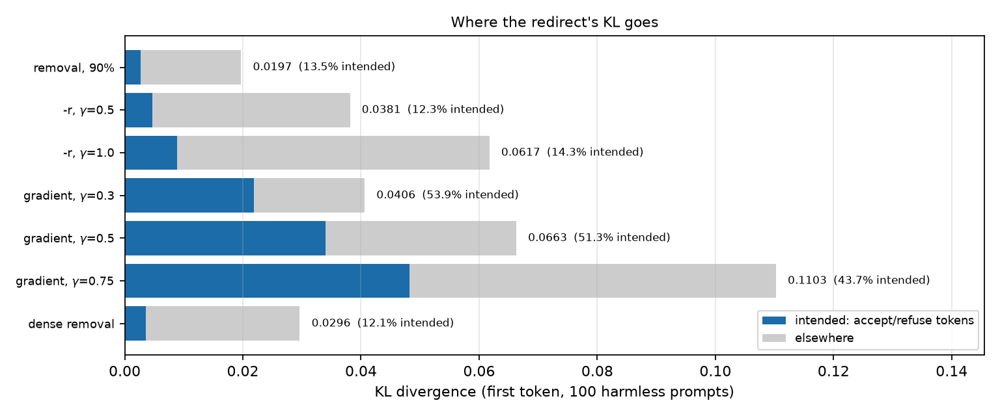

*Figure 5. KL split into mass moving between the 9 acceptance and 6 refusal
openers, which is the behaviour the edit is asked to change, and everything
else. At `gamma = 0.3` the acceptance gradient puts 53.9% of its KL in the
intended set, against 13.5% for removal and 12.1% for dense removal. The
disturbance outside those 15 tokens is 0.0187, below dense removal's 0.0261
(`results/redirect/kl_split.json`).*

### The frontier, with both Heretic modes

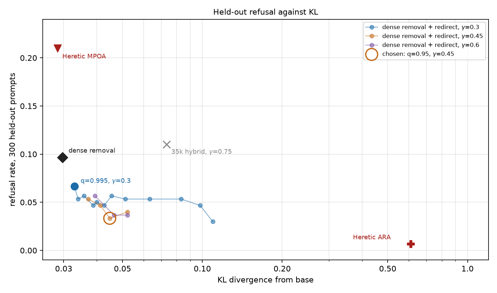

*Figure 6. Held-out refusal against KL for every edit measured here: dense
removal, the family at three values of `gamma`, the sparse family, and both
Heretic modes. The ring is the chosen point, q=0.95 at `gamma = 0.45`. ARA
reaches lower refusal at 13.7 times the KL and a perplexity of 13.61; MPOA is
1.6 times cheaper and 6.3 times worse on refusal.*

Below 0.05 KL the chosen point has the lowest held-out refusal of anything
measured here: 0.033, against 0.097 for dense removal and 0.210 for Heretic
MPOA. ARA is better on refusal and 13.7 times more damaging.

### The category control

The atom set is selected on one category and the others are measured unchanged.
That control exists for no other edit in the study.

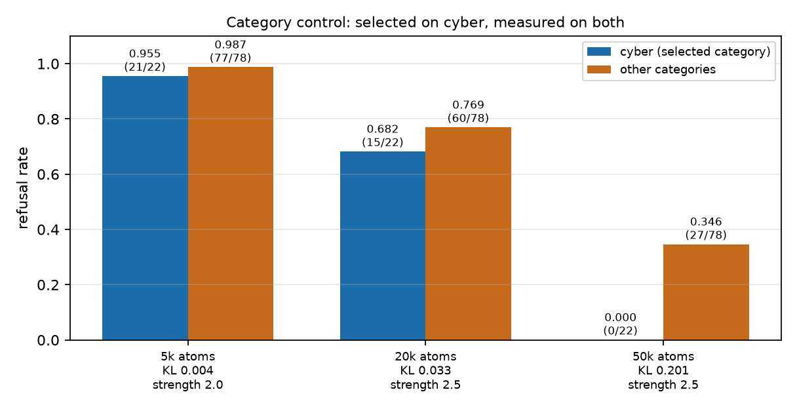

*Figure 7. The atom set is selected on the cyber category; the other categories
are the control. At 50,000 atoms every cyber prompt is converted and 27 of 78
other prompts still refuse (`results/redirect/category_cyber_50k.json`).*

### The graph view

Nodes are `(layer, feature)`. An edge is where a node writes: column `f` of
`down_proj`, scored against the unembedding, names the tokens it pushes toward.
`libershift/graph.py` computes that from the weights, so an edit shows up on the
next read and no index can lag.

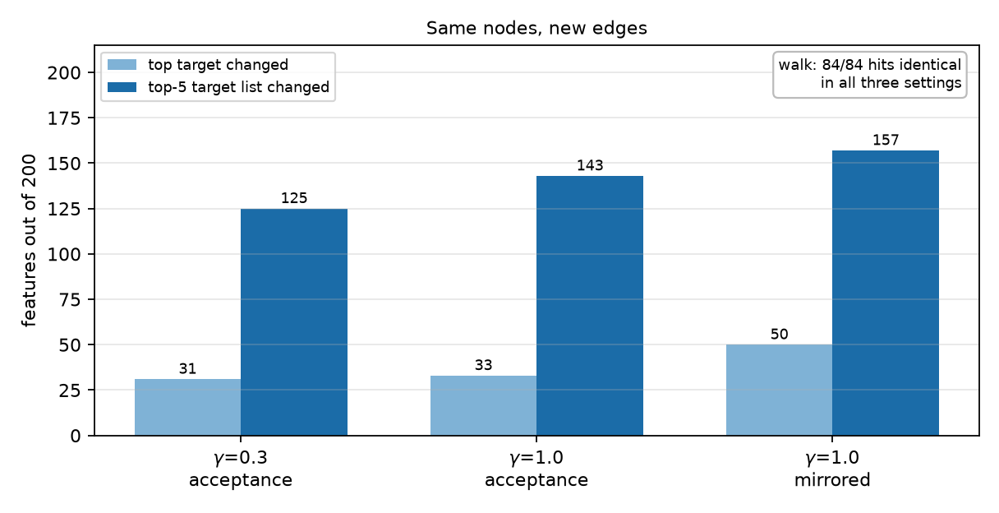

*Figure 8. Of the 200 highest-load features, the top-5 target list moves for 125
at `gamma = 0.3` while the top target alone moves for 31, because every score in
the list shifts but only the winner crossing another changes the top. The gate
walk returns the same 84 features with equal scores, which is the control
(`results/graph/graph_grad_g0.3.json`).*

The gate rows are untouched, so the same features fire on the same prompt with
the same scores. Downstream activations still move, because the residual
changes and later layers read it: in the mirrored-target probe at strength 2.0,
the median activation ratio of 200 selected features on harmful prompts falls to
0.08 (`results/redirect/pilot_rotation_s2.json`). The graph claim is therefore
"the same nodes, new edges", not "the same activations".

[docs/graph.md](docs/graph.md) states the model, the cost of each query and what
it cannot show.

### Capability

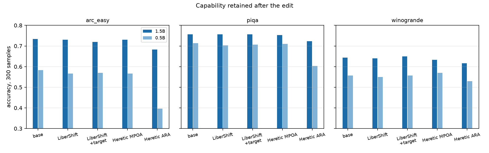

*Figure 9. Accuracy after the edit, 300 samples per task, same prompts for every
model. The abliteration family holds within two points of the base model and the
redirect variant within 1.3. Heretic's ARA loses nineteen points of ARC
accuracy on the 0.5B model.*

Qwen2.5-1.5B-Instruct:

| model | arc_easy | piqa | winogrande |
| --- | --- | --- | --- |
| base | 0.733 | 0.757 | 0.643 |
| dense removal | 0.730 | 0.757 | 0.640 |
| + target on the top 5% | 0.720 | 0.757 | 0.650 |
| Heretic MPOA | 0.730 | 0.753 | 0.633 |
| Heretic ARA | 0.683 | 0.723 | 0.617 |

Qwen2.5-0.5B-Instruct:

| model | arc_easy | piqa | winogrande |
| --- | --- | --- | --- |
| base | 0.583 | 0.713 | 0.557 |
| dense removal | 0.567 | 0.703 | 0.550 |
| + target on the top 5% | 0.570 | 0.707 | 0.557 |
| Heretic MPOA | 0.567 | 0.710 | 0.570 |
| Heretic ARA | 0.397 | 0.603 | 0.530 |

On the 1.5B model the target changes the weights 1.0% more than the removal does
(relative change 0.0253 against 0.0250) and loses 1.3 points of `arc_easy`. On
the 0.5B model it loses 1.3 points of `arc_easy` and 0.6 of `piqa` against base
and matches base on winogrande; against dense removal it is 0.3 to 0.7 points
better on all three. Every difference is inside the suite's 2.5 to 2.9 point
standard error.

### The second model

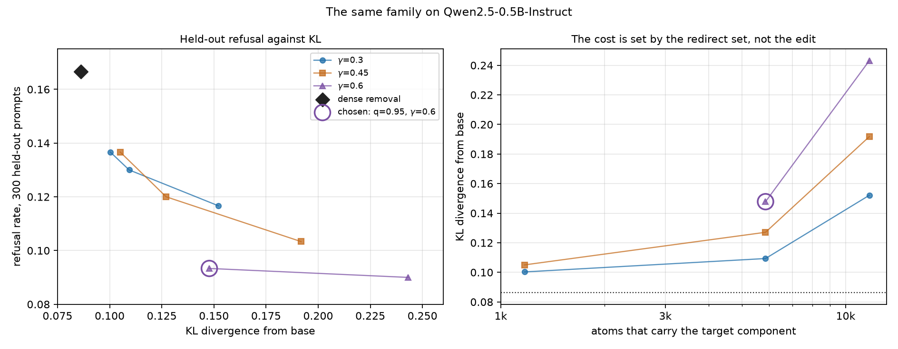

*Figure 10. The same family on Qwen2.5-0.5B-Instruct at plane 14, same two
panels as figure 2. Dense removal gives 0.167 at 0.0862; the target on the top
5% gives 0.130 at 0.1093, and at `gamma = 0.6` 0.093 at 0.1478.*

Dense removal gives 0.080/0.167/0.0862/18.07. The target on the top 5% at
`gamma = 0.3` gives 0.030/0.130/0.1093, and at `gamma = 0.6`
0.040/0.093/0.1478. The gain is smaller than on the 1.5B model: at
`gamma = 0.6` the held-out cut is 44% at 1.7 times the removal's KL, against
66% at 1.5 times there. Heretic's MPOA still wins on
this model, 0.137 at 0.0330; ARA reaches 0.000 at 3.1484 and a perplexity of 107.

The sparse redirect replicates there too, at plane 14 with 16,894 atoms and its
target fitted on that model's own prompts: `gamma = 0.3`, q=0.40 gives
0.100/0.237/0.0783 against 0.120/0.257/0.1017, and `gamma = 0.75`, q=0.30 gives
0.060/0.133/0.2084 against 0.060/0.140/0.2830. This is a replication, not a
transfer of the 1.5B target (`results/redirect/redirect_05b.json`). The redirect's
KL is 2.1 times the removal's on 1.5B and 2.4 times on 0.5B at `gamma = 0.3`; the
hybrid cuts the 0.5B KL by 23% at `gamma = 0.3` and 26% at `gamma = 0.75`.

## How it works

### 1. Read the trace

A decoder block writes into the residual stream through a sum of parts:

```
h[l+1] = h[l] + a[l] + f[l]
```

Both writes break into atoms exactly. `a[l]` is the sum over attention heads of
`W_O[:, h] @ o_h`, where `o_h` is a block of `o_proj`'s input. `f[l]` is the sum
over FFN features of `c_f * d_f`, where `c_f` is a row of `down_proj`'s input
and `d_f` is column `f` of `down_proj`.

Both decompositions are measured, not assumed: they reproduce the writes to 2e-3
and 4e-3 relative in bfloat16, which is the forward pass's own precision
(`results/sanity.json`).

### 2. Attribute the direction

Take the difference of mean residuals between 400 harmful and 400 harmless
prompts at the last position, remove its component along the harmless mean,
and normalise. That is the refusal direction `r[l]` for each plane.

Each atom's contribution to the mean projection is

```
lambda_u = (mean_bad[c_u] - mean_good[c_u]) * (w_u . r)
```

The lambdas sum to the layer's measured change in projection, to 4.8e-4 relative
across every layer (`results/sanity.json`). The positive load splits 89% FFN and
11% attention; negative contributions cancel part of it, so the signed per-layer
sum is 208.9.

### 3. Respect what the measurements rule out

Four plausible shortcuts fail, and the failures shape the method:

| idea | measurement |
| --- | --- |
| ablate only the atoms that carry the most load | 90% of load in one pass leaves 44% refusal, a second round 21%, only every atom 8% ([atoms](results/analysis/atoms/)) |
| ablate the last plane's direction | the projection is zero by construction and 58% of refusals remain ([plane 28](results/analysis/planes/plane_28.json)) |
| ablate only the layers that carry the most load | one layer 0.96, seven 0.92, fourteen 0.39, all 0.24 ([causal layers](results/analysis/causal_layers.json)) |
| scale each layer by its measured load | 0.79 refusal at 37% of the relative weight change ([calibration](results/analysis/calibration.json)) |

The reasons are structural. Removing a direction from a subset of atoms leaves it
in the matrix's range, so the remaining columns can produce it again. Refusal
behaves like a threshold, so a partial reduction does not remove it. And the
direction rotates with depth: the cosine between `r[2]` and `r[28]` is 0.04
(`results/analysis/direction_geometry.json`), so the last plane measures the
outcome rather than the cause.

The plane is the removal edit's only free parameter. It is calibrated on 30
harmful prompts disjoint from the reported ones, at a cost of 12 s for six
candidates.

### 4. Apply the edit

What works is one rank-1 projection per matrix, at every layer:

```
M <- M - r (r^T M)
```

with every atom's write vector scaled back to its original norm; a column whose
post-edit norm would fall below a quarter of the original keeps its scale
instead, so the edit never amplifies a nearly-removed column. A positive
rescale leaves the column space fixed, so after the edit the matrix cannot
produce `r` for any input. The gate and up matrices stay untouched, so the
model's activation pattern is unchanged.

This is Arditi et al.'s weight orthogonalization. Preserving the norm after the
update follows grimjim, applied here to each atom's write vector rather than to
each matrix row; see [What was already done](#what-was-already-done).

The redirect in [The edit](#the-edit) changes nothing else: same atoms, same
matrices, one target component added to the selected columns. Everything above
this line is prior art; the rest of the document measures that addition.

### 5. Ship it as data

The edit is rank one per matrix, so a patch stores one direction per layer plus
one norm scale per atom: **754 KB against a 3.1 GB checkpoint**. Re-applying the
patch to a pristine copy reproduces the exported model with a maximum logit
difference of 0.0 over 16 prompts (`results/patch_verify.json`).

The redirect also ships as an operator patch: one direction and one target per
layer, 514,340 bytes for the 35,043-atom point and 519,204 for `gamma = 0.75`,
and replay reproduces the exported model to zero logit difference
(`results/redirect/export/`). The factorisation follows LoRA and task arithmetic;
the exact replay guarantee is this repository's.

The configuration in the first table is exported as a checkpoint
(`scripts/45_export_family.py`) and reloads to the same 0.030/0.033/0.0447/11.88,
so the numbers survive safetensors and bfloat16. It has no patch yet: the
container stores one index set per matrix kind per layer, so a layer whose
removed atoms and target atoms are both FFN features needs a per-atom `gamma`
array or a second entry.

## Timing

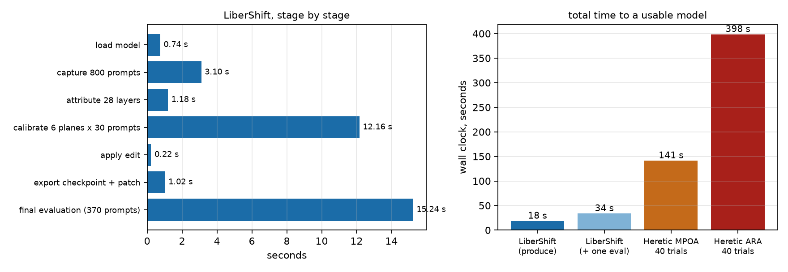

*Figure 11. Where the time goes, against the two Heretic runs on the same
hardware.*

The pipeline has no trial loop: load the model, capture 800 prompts, compute
the directions, attribute 28 layers, calibrate six planes on 30 prompts, apply
the edit, export. That is 18.4 s for a 1.5B model on one laptop GPU, against
141.3 s for a 40-trial Heretic MPOA run and
398.5 s for ARA on the same hardware (`results/timing.json`). With the plane
fixed by the customary 0.65-depth rule the whole pipeline is 6.3 s.

Evaluation is generation-bound, and the batch size is the one free knob there.
At 32 prompts per pass a `measure` call takes 9.5 s; at 128 it takes 5.1 s,
median of two runs, because generation falls from 4.6 s to 1.9 s and the two
projection passes run in one batch instead of four. KL agrees to three decimals
and refusal counts differ by at most one prompt in a hundred across all four
comparison checkpoints, so the sweeps could have been 46% cheaper at the cost of
a 4e-4 KL shift (`results/batch_timing.json`,
`results/batch_parity_1.5b.json`). The tables keep 32 so every reported number
was produced the same way.

## What was already done

The removal edit is Arditi et al.'s weight orthogonalization, with the
norm-preservation idea from grimjim. The plane search is Arditi's layer
selection, reduced. The comparison uses Heretic's refusal markers, KL definition
and system prompt.

| component | first published in | relation |
| --- | --- | --- |
| `M <- M - r (r^T M)` on every matrix that writes to the residual stream | [Arditi et al. 2024](https://arxiv.org/abs/2406.11717), Eq. 5 | identical edit |
| one direction from one plane, applied at every layer | [Arditi et al. 2024](https://arxiv.org/abs/2406.11717) | identical |
| choose the plane by refusal on a prompt set | [Arditi et al. 2024](https://arxiv.org/abs/2406.11717), `select_direction` | same procedure, reduced from layer by position to six planes |
| project the direction against the harmless mean | [grimjim, projected abliteration](https://huggingface.co/blog/grimjim/projected-abliteration), 2025 | identical |
| preserve the norm after the rank-1 update | [grimjim, norm-preserving biprojected abliteration](https://huggingface.co/blog/grimjim/norm-preserving-biprojected-abliteration), 6 Nov 2025 | same goal; this edit rescales each atom's write vector, grimjim each matrix row |
| edit every layer, never a subset | Arditi et al.; [grimjim](https://huggingface.co/blog/grimjim/norm-preserving-biprojected-abliteration) cites the [Hydra effect](https://arxiv.org/abs/2307.15771) | same conclusion, already argued |
| attribute refusal to attention heads from the refusal direction | [RDSHA](https://arxiv.org/abs/2508.19697) | same idea, no weight edit |
| attribution does not track causal effect | [How Alignment Routes](https://arxiv.org/abs/2604.04385) | same finding at circuit level |
| a compact rank-r delta as the artifact | [LoRA](https://arxiv.org/abs/2106.09685), [task arithmetic](https://arxiv.org/abs/2212.04089) | standard |
| held-out abliteration comparison across methods and models | [Young 2026](https://arxiv.org/abs/2611.17846) | stronger version of the comparison here |

The removal half is a configuration of known parts, and the table states each
debt. The contribution is the other half: the redirect operator with `a`
measured as the acceptance gradient, its operating point, and the evidence that
the cheaper variants fail. The same experiment supplies the category control and
the KL split, which the removal edit and its published variants do not have.

[docs/related-work.md](docs/related-work.md) states the boundary work by work.

## Claims and evidence

Twenty-six claims, each with the file that supports it. Sixteen establish the
redirect and the gain it produces, two of them by elimination; nine are
measurements and engineering on prior art; one is the negative result that
pins the frontier — the cheaper target designs fail.

| # | claim | kind | evidence |
| --- | --- | --- | --- |
| 1 | redirecting the refusal component instead of deleting it lowers 90%-load refusal from 0.52 to 0.15 on the 100-prompt evaluation slice and from 0.44 to 0.18 held out | measurement | [gradient sweep](results/redirect/gradient_summary.json), [removal control](results/redirect/pilot_plane18.json), [probe](results/redirect/pilot_probe.json) |
| 2 | the acceptance gradient is nearly orthogonal to the refusal direction, cosine at most 0.153 | measurement | [gradient sweep](results/redirect/gradient_summary.json) |
| 3 | the sparse redirect reaches 0.06 on the 100-prompt slice and 0.117 held out with 14% of the dense edit's atoms, at 3.7 times its KL | measurement | [gradient sweep](results/redirect/gradient_summary.json) |
| 4 | over half of that KL is the accept/refuse redistribution the method intends; the unintended part is below the dense edit's | measurement | [KL split](results/redirect/kl_split.json) |
| 5 | the redirect is category-selective: 0.00 cyber refusal against 0.35 for the other categories | measurement | [cyber, 50k atoms](results/redirect/category_cyber_50k.json) |
| 6 | the redirect ships as a 0.5 MB operator patch that replays to 0.0 logit difference, and the reloaded model measures the same as the in-memory edit | engineering | [patch verify](results/redirect/export/redirect_g0.3_verify.json) |
| 7 | the edit is visible on a graph read straight from the weights: the top-5 target list moves for 125 of the 200 highest-load features (62.5%) while the same 84 features fire with equal gate scores | measurement | [graph view](results/graph/graph_grad_g0.3.json) |
| 8 | one-pass atom sparsity fails: 90% of the attributed load leaves 44% refusal, and a second round reaches 21% | measurement | [90% one pass](results/analysis/atoms/local_0.90_1.json), [90% two rounds](results/analysis/atoms/local_0.90_2.json) |
| 9 | a trace score ranks plane 22 first, while plane 18 is the measured optimum | measurement | [sweep](results/analysis/plane_sweep.json), [plane 18](results/analysis/planes/plane_18.json) |
| 10 | attention carries 11% of the write and 31 of the 92 refusal points the edit removes | measurement | [path ablation](results/analysis/paths_layers.json) |
| 11 | 30 calibration prompts do not separate candidate planes on the 0.5B model: planes 14, 16 and 18 tie at one refusal, and the four measured planes span 0.113 to 0.167 held out | measurement | [held-out by plane](results/analysis/holdout_by_plane_05b.json), [calibration](results/analysis/calibration_05b.json) |
| 12 | an exact attribution identity used as a gate, 4.8e-4 relative across every layer and both paths | method | [sanity](results/sanity.json) |
| 13 | the calibrated pipeline runs in 18.4 s, or 6.3 s with the plane fixed | engineering | [timing](results/timing.json) |
| 14 | the removal edit ships as 754 KB of rank-1 factors and replays to 0.0 logit difference | engineering | [patch verify](results/patch_verify.json) |
| 15 | transformers 5.x returns a post-norm last plane; the capture reconstructs the pre-norm one to 2.2e-6 | engineering | [parity](results/parity.json) |
| 16 | among a fixed 35,043 atoms, removing the atoms with the worst conversion per unit of harmless write and redirecting the rest cuts KL by 13.7% at `gamma = 0.3` (q=0.25) and 33.5% at `gamma = 0.75` (q=0.30), against redirecting every atom; refusal stays inside the sampling error | measurement | [hybrid sweep](results/redirect/hybrid_efficiency_fine.json) |
| 17 | the redirect replicates on the 0.5B model and the hybrid improves it there too: `gamma = 0.3`, q=0.40 gives 0.100/0.237/0.0783 against 0.120/0.257/0.1017; `gamma = 0.75`, q=0.30 gives 0.060/0.133/0.2084 against 0.060/0.140/0.2830 | measurement | [0.5B redirect](results/redirect/redirect_05b.json) |
| 18 | a phrase weight sweep does not beat the acceptance gradient: `lambda = 0` gives 0.100/0.230 at `gamma = 0.3` and 0.070/0.123 at `gamma = 0.75`; raising `lambda` to 4 lifts the phrase logprob from -19.9 to -14.5 at `gamma = 0.3` and from -20.0 to -11.5 at `gamma = 0.75`, but the phrase appears in 0 of 100 responses at every setting and held-out refusal rises | measurement | [phrase weight](results/redirect/phrase_weight.json) |
| 19 | the shipped edit removes every atom and puts the target on the efficient 5%: 12,561 atoms at `gamma = 0.45` take held-out refusal from 0.097 to 0.033 at 1.51 times the KL (0.0447 against 0.0296) and the same perplexity (11.88) | measurement | [family](results/redirect/dense_hybrid_family.json) |
| 20 | the target's cost follows the number of atoms that carry it, not the number removed: with all atoms removed, the target on 1,256 atoms reaches 0.067 held out at 0.0329, and on 138,169 atoms 0.030 at 0.1094 | measurement | [family](results/redirect/dense_hybrid_family.json) |
| 21 | four attempts to make the target cheaper fail: orthogonalising it against `r`, against the mean harmless gradient, or against the top 32 harmless gradient directions, and allocating `gamma` per layer by measured conversion, all leave the frontier where it is or move it the wrong way | measurement, negative | [target variants](results/redirect/smart.json) |
| 22 | a 128-prompt batch makes evaluation 1.85 times faster: refusal counts change by at most one prompt in a hundred and KL by at most 4e-4 across the four comparison checkpoints | engineering | [batch timing](results/batch_timing.json), [parity](results/batch_parity_1.5b.json) |
| 23 | on Qwen3.5-4B, the hybrid model Heretic's PR #211 reports as resisting classic abliteration, dense removal in this harness stalls at 0.39 held out from a 0.60 base (0.93 base refusal on the evaluation slice) | measurement | [base](results/qwen35_base.json), [calibration](results/analysis/qwen35_calibration.json), [family](results/redirect/dense_hybrid_35b.json) |
| 24 | on the same model, carrying the target on the efficient 5% of atoms takes held-out refusal to 0.23 at 0.1944 KL with unchanged perplexity, capability inside sampling noise, and the exported checkpoint measures the same after reload | measurement | [export](results/redirect/export_35b.json), [holdout](results/holdout_Qwen3.5-4B.json), [bench base](results/bench_base_35b.json), [bench shipped](results/bench_taa_35b.json) |
| 25 | the target's cost follows the number of atoms that carry it on the hybrid too: `q = 0.5` at `gamma = 0.3` spends 4.06 KL for 0.34 held out | measurement | [family](results/redirect/dense_hybrid_35b.json) |
| 26 | on the same model, Heretic's own search measured in this harness (same checkout, 40 trials, seed 12345): MPOA 0.55/0.29 at 0.1027 KL, ARA 0.03/0.01 at 1.0832 KL with PPL 13.57 and a four-point capability drop; the shipped point beats MPOA on both refusal columns at 1.9 times its KL, and ARA's near-zero costs 5.6 times the shipped KL | measurement | [comparison](results/comparison_Qwen3.5-4B.json), [trials](results/heretic_35b_trials.json), [bench mpoa](results/bench_heretic_mpoa_35b.json), [bench ara](results/bench_heretic_ara_35b.json) |

## Install

Python 3.10 or newer, and a GPU with enough memory for the model. The study used
Python 3.12 and an RTX 5080 Laptop with 16 GB.

```sh
uv venv --python 3.12 .venv
# Blackwell / RTX 50-series need CUDA 13 wheels; pick the index for your GPU
uv pip install --python .venv/bin/python torch torchvision \
    --index-url https://download.pytorch.org/whl/cu132
# torch is already installed, so this step must not touch it
uv pip install --python .venv/bin/python -r requirements.txt
```

Fetch a model:

```sh
.venv/bin/hf download Qwen/Qwen2.5-1.5B-Instruct --local-dir models/Qwen2.5-1.5B-Instruct
```

That is the default location. `LIBERSHIFT_MODELS=/path/to/checkpoints` reads
them from somewhere else; nothing else in the repository needs a particular
directory layout.

## Run

```sh
# Gate 1: the trace contract and the attribution identity. About 30 seconds.
PYTHONPATH=. .venv/bin/python scripts/01_sanity.py

# The full method: capture, attribute, calibrate, edit, measure.
PYTHONPATH=. .venv/bin/python scripts/11_calibrate.py

# Export the chosen edit as a checkpoint and a re-applicable patch.
PYTHONPATH=. .venv/bin/python scripts/06_export.py --name libershift \
    --layers all --kinds feature,head --direction plane:18 --verify-patch

# The redirect: acceptance gradient, then the sweep over targets and scales.
PYTHONPATH=. .venv/bin/python scripts/24_gradient_redirect.py --modes neg_r,grad

# Split the harmless-prompt KL into the intended redistribution and the rest.
PYTHONPATH=. .venv/bin/python scripts/25_kl_split.py

# Export a redirect as a checkpoint and an operator patch, then replay it.
PYTHONPATH=. .venv/bin/python scripts/26_export_redirect.py \
    --name redirect_g0.3 --gamma 0.3 --verify-patch

# The graph view: same nodes, new edges, read straight from the weights.
PYTHONPATH=. .venv/bin/python scripts/29_graph_view.py --gamma 0.3

# The family in the first table: every atom loses the refusal component, the
# target goes on the efficient few.
PYTHONPATH=. .venv/bin/python scripts/41_dense_hybrid.py \
    --points "1:0,0.9:0.3,0.95:0.45,0.995:0.3"

# Export the shipped point and measure it again after reloading.
PYTHONPATH=. .venv/bin/python scripts/45_export_family.py \
    --name libershift_target_q0.95_g0.45 --q 0.95 --gamma 0.45

# The sparse hybrid, the target variants and the ranking controls.
PYTHONPATH=. .venv/bin/python scripts/32_hybrid_redirect.py --ranks efficiency \
    --quantiles 0.05,0.1,0.15,0.2,0.25,0.3,0.35,0.4
PYTHONPATH=. .venv/bin/python scripts/44_smart_redirect.py --points "0.95:0.45"

# Batch size and protocol parity across both Heretic checkpoints.
PYTHONPATH=. .venv/bin/python scripts/42_batch_timing.py
PYTHONPATH=. .venv/bin/python scripts/43_batch_parity.py --model 1.5b

# Regenerate the figures in this README from the result files.
PYTHONPATH=. .venv/bin/python scripts/18_figures.py --results results --output docs/figures
```

To reproduce the comparison, clone Heretic next to this repository and run it
with the configurations in `configs/`, then measure every model with one
harness:

```sh
git clone https://github.com/p-e-w/heretic
uv pip install --python .venv/bin/python -e ./heretic
HERETIC_CONFIG_FILE=configs/heretic_mpoa.toml .venv/bin/heretic \
    --model models/Qwen2.5-1.5B-Instruct
PYTHONPATH=. .venv/bin/python scripts/13_compare_model.py --model Qwen2.5-1.5B-Instruct
PYTHONPATH=. .venv/bin/python scripts/16_holdout.py --model Qwen2.5-1.5B-Instruct
```

Heretic needs its own packages (`requirements-comparison.txt`). It is not
vendored here.

## Repository layout

```
libershift/        the method
  capture.py       residual, attention, head and feature captures with the additive contract
  direction.py     per-plane difference-of-means directions, projection, separation
  attribute.py     exact load attribution, identity check, concentration and cost curves
  edit.py          rank-1 ablation with atom-norm restoration; records the operations
  redirect.py      acceptance score, its gradient, the redirect and hybrid edits
  graph.py         node/edge view read from the weights; edges, walk, diff
  patch.py         export and replay of the edit as a rank-1 patch
  evaluate.py      refusal markers (Heretic's list), KL, perplexity, projection readout
  pipeline.py      rounds and configuration
scripts/           one script per experiment, numbered in the order they ran
configs/           Heretic configurations used for the comparison
docs/              method, results, prior work, graph view, figures
results/           frozen outputs: tables, holdouts, benchmarks, timings, raw per-prompt responses
```

[docs/method.md](docs/method.md) states the method and the reasoning.
[docs/results.md](docs/results.md) holds every table, including the failed
ideas. [docs/related-work.md](docs/related-work.md) states what each part owes to
earlier work. [docs/graph.md](docs/graph.md) states the node/edge view and its
cost.

## Scope and limits

Two models from one family are not a broad result. The removal method's one free
parameter is calibrated per model. It transfers on the 1.5B model and does not
on the 0.5B model, where planes 14, 16 and 18 tie at one refusal in thirty;
their held-out rates span 0.137 to 0.167, and the four measured planes span 0.113
to 0.167.

The redirect has a 0.5B result as well: plane 14, 16,894 atoms, with its target
fitted on that model's own 400 harmful prompts. It replicates the conversion and
the hybrid improves its KL, but the redirect's KL is 2.1 times the removal's on
1.5B and 2.4 times on 0.5B at `gamma = 0.3`, and the hybrid cuts the 0.5B KL by
23% at `gamma = 0.3` and 26% at `gamma = 0.75`. On the 1.5B model, the target is
fitted on the same 400 harmful prompts as the direction, and on the 300-prompt
held-out set it ties the mirrored target near KL 0.04 and falls behind it near
0.06; its 0.117 at 0.11 is below every mirrored point, though the mirrored curve
was not measured above 0.06. The KL split that favours it is a post-hoc reading
of the same numbers, and it is reported as one.

The refusal metric is Heretic's keyword list. It flags a compliant answer that
mentions "harmful" or "illegal", so absolute rates overstate refusal. Every
method here is measured by the same code, and a narrower opening-token rate is
recorded next to it.

LiberShift removes or converts a refusal behaviour. The model keeps every other
limitation it had, and nothing here makes it safe. Do not treat a shifted model
as reviewed, aligned or harmless. This repository exists to measure the edit; it
ships no model.

## Licence

Apache-2.0. See [LICENSE](LICENSE).

Heretic is used as an external comparison tool under its own licence (AGPL-3.0)
and is not vendored or redistributed here. No code from another project is
included; `scripts/04_engine_parity.py` is an optional cross-check that drives an
external engine's layer-dump binary, and nothing in the method depends on it.
