# LiberShift: results

Every number in the study, including the ideas that failed. Charts are drawn
from the files in `../results/` by `../scripts/18_figures.py`.

These tables are the contribution. The removal edit they measure is prior art:
Arditi et al.'s weight orthogonalization with grimjim's norm preservation. The
redirect in `## The redirect` is the new edit: a measured gain at the same
atoms, a category control, and a KL split. See
[related-work.md](related-work.md) for the boundary and the citations.

## Setup

Method runs use `libershift/` in this repository. The comparison runs use a
Heretic checkout at commit `64e9991` (version 2.2.0.dev0), configured by the
files in `../configs/`: 40 trials, 15 startup trials, seed 12345, greedy
decoding with a 100-token response cap and Heretic's default system prompt.
Capability comes from lm-eval with 300 samples per task. All runs used one
RTX 5080 Laptop with 16 GB.

Every Libershift number is measured at 32 prompts per forward pass, which is the
setting the first results used. Heretic auto-selects the largest batch that fits
and chose 128 here, so the two methods were originally measured at different
batch sizes. `scripts/43_batch_parity.py` re-measures all four comparison
checkpoints at both sizes: KL agrees to three decimals and refusal counts differ
by at most one prompt in a hundred. The study keeps 32 so every number in it
comes from one protocol; the 1.85 times saving from 128 is available and
measured. On the Qwen3.5-4B hybrid, the passes that carry all 33 hidden-state
planes use 12 prompts and the gradient passes 4, because the linear-attention
kernel's transients exceed a 16 GB GPU otherwise; generation, KL and perplexity
keep the 32-prompt protocol.

Three prompt sets, kept apart:

* **calibration** — 30 harmful prompts, used only to choose the edit plane.
* **report** — the other 70 harmful prompts of Heretic's evaluation slice.
* **held out** — 300 harmful prompts from two other datasets: the 100 harmful
  goals of JailbreakBench (HarmBench-derived) and 200 unsafe prompts from
  BeaverTails. No method saw these during fitting, calibration or reporting.

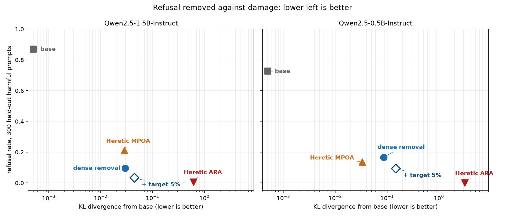

*Figure 1. Refusal on 300 held-out harmful prompts against KL divergence from
the base model. Lower left is better. Heretic's ARA reaches near-zero refusal at
0.61 KL on the 1.5B model and 3.15 on the 0.5B model, against about 0.03 for the
other edits. The open diamond is dense removal plus the target on the efficient
5%, which is the shipped configuration.*

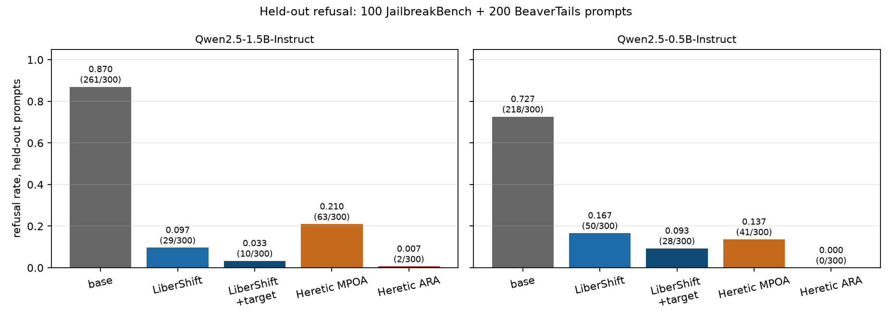

*Figure 3. Held-out refusal rates with counts out of 300.*

## The three models

| | Qwen2.5-1.5B-Instruct | Qwen2.5-0.5B-Instruct | Qwen3.5-4B |
| --- | --- | --- | --- |
| layers | 28 | 24 | 32 |
| hidden | 1536 | 896 | 2560 |
| query heads | 12 | 14 | 16 |
| FFN width | 8960 | 4864 | 9216 |
| attention families | one | one | hybrid: 24 linear, 8 full |
| atoms per layer | 8,972 | 4,878 | 13,312 |
| plane chosen by calibration | 18 (0.64 of depth) | 14 (0.58 of depth) | 20 (0.63 of depth) |

On the 0.5B model planes 14, 16 and 18 tie at one refusal out of thirty, so the
tie breaks to the lowest index. The calibration is decisive on the 1.5B model
(1, 1, 7 and 14 refusals out of 30 for planes 18, 20, 22 and 24) and coarse on
the small one. On Qwen3.5-4B the hybrid layers do not share a head layout, so
the attention atom is one output column (4,096 per layer instead of heads) and
the calibration ran dense removal on the 70-prompt slice for planes 16 to 24:
0.81, 0.86, 0.63, 0.64 and 0.73, choosing plane 20.

## Refusal and damage

Refusal is Heretic's keyword rate. KL is Heretic's first-token KL on 100
harmless prompts against the base checkpoint. PPL is wikitext-2.

### Qwen2.5-1.5B-Instruct

| model | report (70) | held out (300) | KL | PPL | rel. weight change |
| --- | --- | --- | --- | --- | --- |
| base | 1.00 (70/70) | 0.87 (261/300) | 0 | 11.54 | 0 |
| **LiberShift**, dense removal | 0.07 (5/70) | 0.10 (29/300) | **0.0296** | 11.88 | 0.0250 |
| **LiberShift**, target on the top 5% | **0.04 (3/70)** | **0.03 (10/300)** | 0.0447 | 11.88 | 0.0253 |
| Heretic MPOA, 40 trials | 0.23 (16/70) | 0.21 (63/300) | 0.0285 | 11.57 | adapter |
| Heretic ARA, 40 trials | 0.00 (0/70) | 0.007 (2/300) | 0.6120 | 13.61 | adapter |

### Qwen2.5-0.5B-Instruct

| model | report (70) | held out (300) | KL | PPL | rel. weight change |
| --- | --- | --- | --- | --- | --- |
| base | 0.90 (63/70) | 0.73 (218/300) | 0 | 17.69 | 0 |
| **LiberShift**, dense removal | 0.10 (7/70) | 0.17 (50/300) | **0.0862** | 18.07 | 0.0326 |
| **LiberShift**, target on the top 5% | 0.06 (4/70) | 0.09 (28/300) | 0.1478 | 18.11 | 0.0330 |
| Heretic MPOA, 40 trials | 0.09 (6/70) | 0.14 (41/300) | 0.0330 | 17.73 | adapter |
| Heretic ARA, 40 trials | 0.00 (0/70) | 0.000 (0/300) | 3.1484 | 106.61 | adapter |

On the 1.5B model LiberShift removes 89% of the held-out refusals at 0.03 KL,
where Heretic's search removes 76% at the same KL. With the target on the
efficient 5% it removes 96% at 0.0447, which is 1.6 times MPOA's KL for six times
less refusal, and 13.7 times less KL than ARA for 5.0 times its refusal. On the
0.5B model Heretic's abliteration reaches 14% against 17%, at 2.6 times less KL.

Heretic's ARA removes almost every refusal and, on the 0.5B model, produces a
checkpoint with a perplexity of 107. Its objective does contain Heretic's KL
score, and 40 trials on a small model reached a destructive point on the Pareto
front anyway.

### Qwen3.5-4B

Qwen3.5-4B is the model Heretic's ARA pull request
([#211](https://github.com/p-e-w/heretic/pull/211)) reports as resistant to
classic directional ablation: after abliteration, more than 50 of 100 harmful
prompts still refuse, and only the ARA search gets the model to 4 of 100, at
0.1396 KL. It is also architecturally modern: 24 of its 32 layers are linear
attention, so the harness edits one attention-output column per atom
(`docs/method.md`, "Hybrid decoders"). Everything below is measured in this
repository's harness; the two Heretic rows are the PR's own reported numbers,
stated for provenance and not re-measured here.

| model | eval (100) | held out (300) | KL | PPL | rel. weight change |
| --- | --- | --- | --- | --- | --- |
| base | 0.93 (93/100) | 0.60 (180/300) | 0 | 10.72 | 0 |
| **LiberShift**, dense removal | 0.61 (61/100) | 0.39 (116/300) | **0.0567** | 10.87 | 0.0145 |
| **LiberShift**, target on the top 5%, `gamma = 0.75` | **0.49 (49/100)** | **0.23 (69/300)** | 0.1944 | 10.87 | 0.0148 |
| Heretic MPOA, 40 trials | 0.55 (55/100) | 0.29 (88/300) | 0.1027 | 10.74 | adapter |
| Heretic ARA, 40 trials | 0.03 (3/100) | 0.01 (3/300) | 1.0832 | 13.57 | adapter |

Both Heretic rows are measured, not quoted: the same Heretic checkout as the
1.5B and 0.5B comparison (2.2.0.dev0 at commit `64e9991`), 40 trials, 15
startup trials, seed 12345, on this checkpoint, its exported best trial
measured by the same harness as every other row. The pull request that
motivated this run reports ">50/100" for abliteration on this model; the
measured MPOA search here lands at 0.55 eval and 0.29 held out, better than
that report, and its optimiser's best MPOA trial scored 25/100 on its own
scorers (`heretic_35b_trials.json`).

The removal reproduces the PR's core observation and stalls: from a 0.93 base
refusal it reaches 0.39 held out, 36% of the way to zero. The redirect moves
where removal stops: the target on the efficient 5% of atoms (21,299 columns)
at `gamma = 0.75` takes held-out refusal to 0.23, 62% of the way down and below
measured MPOA's 0.29, at 1.9 times MPOA's KL and the same perplexity as the
removal. The cost rule of the two dense models holds here too: dropping the
target onto half the atoms at the same `gamma` spends 4.06 KL for 0.34 held
out. Heretic's ARA removes nearly everything (0.03 eval, 0.01 held out) at
5.6 times the shipped point's KL, with a perplexity of 13.57 against 10.72 and
a capability cost of about four points on every task.

The 70-prompt slice that calibration consumed is inside the eval-100 column, so
that column is calibration-adjacent; the held-out 300 is untouched by
calibration, fitting or reporting. The capability suite moves within sampling
noise for the shipped edit: arc_easy 0.797 to 0.793, piqa 0.793 to 0.797,
winogrande 0.703 to 0.707 (300 samples each, `bench_base_35b.json`,
`bench_taa_35b.json`). The reloaded exported checkpoint measures the same as
the in-memory edit (`redirect/export_35b.json`).

### Where the calibration fails

On the 0.5B model the calibration does not transfer. Planes 14, 16 and 18 all
scored one refusal out of thirty, the tie broke to 14, and the held-out rates
are not equal:

| plane | calibration (30) | held out (300) |
| --- | --- | --- |
| 14 | 0.03 | 0.167 (50/300) |
| 16 | 0.03 | 0.140 (42/300) |
| 18 | 0.03 | 0.137 (41/300) |
| 20 | not in the six-plane calibration | 0.113 (34/300) |

Plane 20 was evaluated after the fact, not as one of the six calibration
candidates, and it has the lowest held-out rate of the four. The sweep behind
this table is a post-hoc diagnostic, not part of the method; picking plane 20
from it would be fitting to the report set. What it shows is that thirty prompts
do not separate candidate planes on this model. Had the tie broken to plane 18,
the 0.5B result would tie Heretic's 0.137; had plane 20 been a candidate, it
would beat it at 0.113. The calibration's choice of plane 14 leaves it 0.030
behind Heretic, on a search over six candidates with 30 prompts.

## Capability

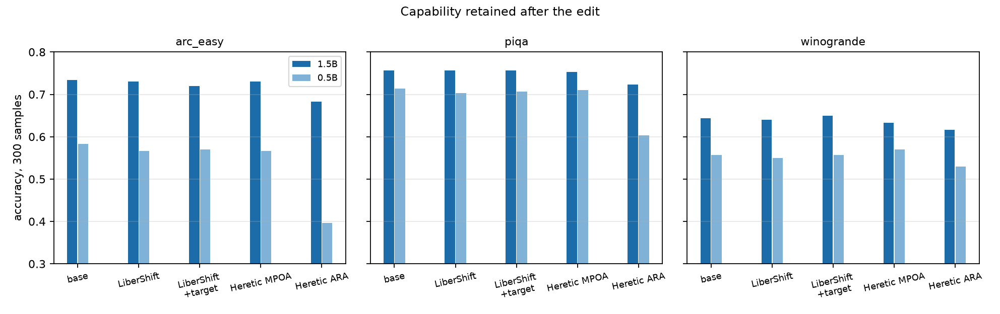

*Figure 9. Accuracy after the edit, 300 samples per task, same prompts for
every model. Both models, and the target variant on both.*

`arc_easy`, `piqa`, `winogrande`, 300 samples each. Standard error is about 2.5
points.

### Qwen2.5-1.5B-Instruct

| model | arc_easy | piqa | winogrande |
| --- | --- | --- | --- |
| base | 0.733 | 0.757 | 0.643 |
| LiberShift | 0.730 | 0.757 | 0.640 |
| LiberShift + target on the top 5% | 0.720 | 0.757 | 0.650 |
| Heretic MPOA | 0.730 | 0.753 | 0.633 |
| Heretic ARA | 0.683 | 0.723 | 0.617 |

### Qwen2.5-0.5B-Instruct

| model | arc_easy | piqa | winogrande |
| --- | --- | --- | --- |
| base | 0.583 | 0.713 | 0.557 |
| LiberShift | 0.567 | 0.703 | 0.550 |
| LiberShift + target on the top 5% | 0.570 | 0.707 | 0.557 |
| Heretic MPOA | 0.567 | 0.710 | 0.570 |
| Heretic ARA | 0.397 | 0.603 | 0.530 |

The abliteration family loses at most 1.7 points, inside one standard error. The
shipped configuration, measured on its exported checkpoint, loses 1.3 points of
ARC accuracy on both models and gains 0.7 on winogrande on the 1.5B model; on
the 0.5B model it matches base on winogrande and beats dense removal on all
three tasks. ARA loses nineteen points of ARC accuracy on the 0.5B model,
consistent with its perplexity of 107.

## The artifact

A full-coverage edit is rank one per matrix, so a patch stores one direction per
layer plus one norm scale per atom instead of replacement weights.

| model | checkpoint | patch | layers | replay error |
| --- | --- | --- | --- | --- |
| Qwen2.5-1.5B-Instruct | 3.1 GB | 754 KB | 28 | 0.0 logit difference over 16 prompts |
| Qwen2.5-0.5B-Instruct | 1.0 GB | 380 KB | 24 | 0.0 logit difference over 16 prompts |

The 0.5B patch is 380,327 bytes for 117,072 atoms; the replay is
`../results/patch_verify_05b.json`. The 1.5B replay is
`../results/patch_verify.json`.

`libershift.patch.apply_patch` reads a pristine checkpoint and reproduces the
exported model exactly.

## Cost

One RTX 5080 Laptop GPU, 16 GB, 1.5B model, GPU otherwise idle, clock
synchronised before every reading (`../scripts/17_timing.py`).

| stage | seconds |
| --- | --- |
| load the model | 0.74 |
| capture 800 prompts | 3.10 |
| attribute all 28 layers | 1.18 |
| calibrate 6 planes on 30 prompts | 12.16 |
| apply the edit | 0.22 |
| export checkpoint and patch | 1.02 |
| **subtotal, model produced** | **18.4** |
| final evaluation, 370 prompts | 15.24 |
| **total, model produced and measured** | **33.7** |

Heretic, same GPU, same model, 40 trials, full process wall clock including
model load, its startup batch-size benchmark and the final save:

| run | wall clock | trial loop | per trial |
| --- | --- | --- | --- |
| MPOA | 141.3 s | 115 s | 2.9 s |
| ARA | 398.5 s | 342 s | 8.6 s |

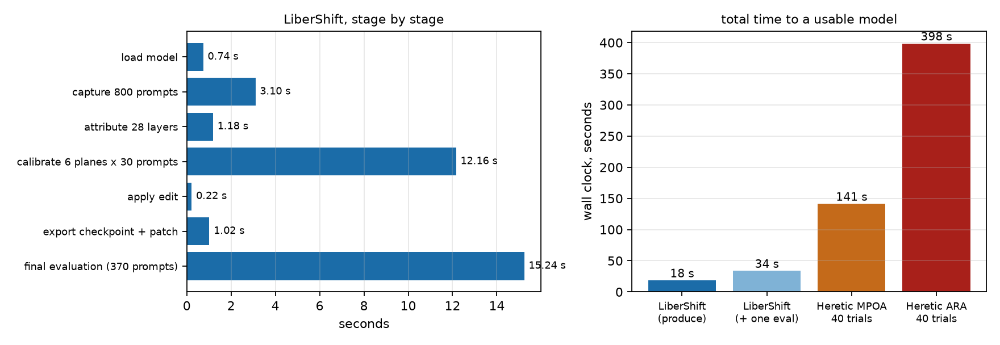

*Figure 11. Stage-by-stage time for LiberShift against the two Heretic runs.*

Producing the model takes 18 s against 141 s (7.7 times faster than MPOA) and
398 s (21.6 times faster than ARA). Counting one evaluation on both sides,
which is what it takes to know the edit worked, the totals are 34 s against
141 s and 399 s: 4.2 and 11.8 times. Heretic's default is 100 trials rather
than 40, which scales its figures by about 2.5.

Most of LiberShift's time is the calibration. With the plane fixed by the
customary 0.65-depth rule the whole pipeline is 6.3 s, and the analysis itself
(capture plus attribution) is 4.3 s.

Evaluation is generation-bound, and the batch size is the one free knob there.
At 32 prompts per pass a `measure` call takes 9.5 s; at 128 it takes 5.1 s
(medians of two runs), because generation falls from 4.6 s to 1.9 s and the two
projection passes run in one batch instead of four. Both settings give KL to
three decimals and refusal counts to one prompt in a hundred, so the sweeps in
this study could have been 46% cheaper at the cost of a 4e-4 KL shift.
`../results/batch_timing.json` and
`../results/batch_parity_1.5b.json` keep both measurements.

The work volume differs more than the clock. Heretic scores 100 harmful and 100
harmless prompts in every trial; the harmless set is a forward pass for KL and
the harmful set is generated, so 40 trials mean 4,000 generations and 8,000
prompt evaluations. LiberShift generates 180 prompts for its calibration and
runs 800 prefills for the capture. Peak GPU memory is the same for both: one
loaded model at about 3 GB.

## The redirect

The comparison tables below use the 90%-load selection from the atom-sparsity
table: 35,043 atoms of the 251,216 the dense edit touches, chosen by attributed
load per unit weight change. The redirect replaces the removal at each selected
atom, so atom set, prompts and measurement code are held fixed. The later
controls (category, teacher, heads, features) state their own selections.

Refusal here is the full 100-prompt evaluation slice, not the 70-prompt report
split of the removal tables. The redirect runs no calibration, so it has no
prompts to reserve, and the 30 calibration prompts are outside its fit set
anyway. The columns are labelled "refusal, 100" wherever that applies.

### Replacing the component

Plane 18, both paths, `a = -r`. "Strength" is the multiplier on the removed
component, so strength 1.0 is removal and strength 2.0 is the sign flip
(`gamma = 1.0`).

| load covered | atoms | strength | refusal | opening refusal | KL |
| --- | --- | --- | --- | --- | --- |
| 50% | 14,631 | 1.0 | 0.94 | 0.80 | 0.0046 |
| 50% | 14,631 | 2.0 | 0.77 | 0.64 | 0.0140 |
| 75% | 25,233 | 1.0 | 0.73 | 0.64 | 0.0120 |
| 75% | 25,233 | 2.0 | 0.39 | 0.36 | 0.0403 |
| 90% | 35,043 | 1.0 | 0.52 | 0.46 | 0.0197 |
| 90% | 35,043 | 2.0 | 0.17 | 0.12 | 0.0614 |
| 100% of positives | 53,626 | 1.0 | 0.37 | 0.33 | 0.0319 |
| 100% of positives | 53,626 | 2.0 | 0.08 | 0.03 | 0.1003 |

The flip converts more refusal than the removal at every row and costs more KL.
At 90% load the same 35,043 atoms go from 0.52 to 0.17 in this run. The gradient
sweep repeats the same sign-flip edit and measures 0.15; the two runs agree on
the removal control (0.520) and differ by two prompts on the flip. The table
below uses the sweep's 0.15.

### Against the dense edit, held out

`a = -r` at `gamma = 1.0`. The gradient target is the acceptance gradient of
§5.3 of `docs/method.md`.

| edit | atoms | refusal, 100 | refusal, 300 held out | KL | PPL |
| --- | --- | --- | --- | --- | --- |
| base | — | 1.000 | 0.870 | — | 11.54 |
| removal, 90% load | 35,043 | 0.520 | 0.437 | 0.0197 | 11.56 |
| redirect, `-r`, `gamma = 1.0` | 35,043 | 0.150 | 0.183 | 0.0617 | 11.60 |
| redirect, gradient, `gamma = 0.3` | 35,043 | 0.110 | 0.230 | 0.0406 | 11.57 |
| redirect, gradient, `gamma = 0.75` | 35,043 | 0.060 | 0.117 | 0.1103 | 11.62 |
| dense removal | 251,216 | 0.060 | 0.097 | 0.0296 | 11.88 |

The gradient target beats `-r` on the 100-prompt evaluation slice at every
scale. On the 300-prompt held-out set it wins above KL 0.10 (0.117 against 0.213
at `gamma = 0.75`) and ties near KL 0.04 (0.230 against 0.243, inside the
sampling error of 300 prompts). The dense removal edit keeps the best held-out
rate per unit KL.

The perplexity column orders differently from the KL column. Dense removal has
the lowest KL and the worst perplexity of the five edits, 11.88 against 11.57
for the gradient redirect.

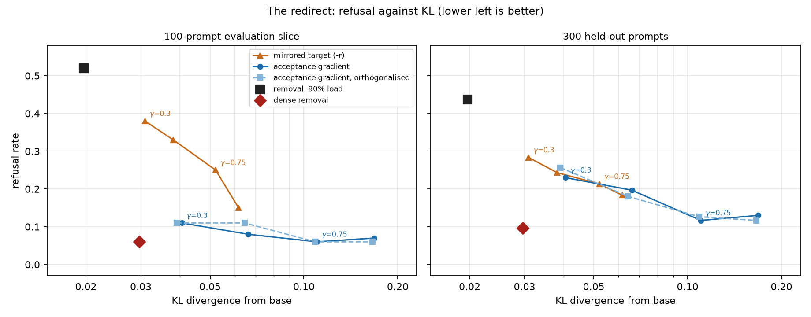

*Figure 4. Refusal against KL for both targets and the controls. The acceptance
gradient reaches lower refusal at a given KL than the mirrored target; the dense
edit is lower still at its own KL.*

### The full sweep

| target | `gamma` | refusal | opening | held out | KL | PPL | rel. change |
| --- | --- | --- | --- | --- | --- | --- | --- |
| `-r` | 0.3 | 0.380 | 0.350 | 0.283 | 0.0309 | 11.57 | 0.0102 |
| `-r` | 0.5 | 0.330 | 0.280 | 0.243 | 0.0381 | 11.58 | 0.0118 |
| `-r` | 0.75 | 0.250 | 0.180 | 0.213 | 0.0521 | 11.59 | 0.0137 |
| `-r` | 1.0 | 0.150 | 0.100 | 0.183 | 0.0617 | 11.60 | 0.0157 |
| gradient | 0.3 | 0.110 | 0.010 | 0.230 | 0.0406 | 11.57 | 0.0083 |
| gradient | 0.5 | 0.080 | 0.000 | 0.197 | 0.0663 | 11.59 | 0.0089 |
| gradient | 0.75 | 0.060 | 0.000 | 0.117 | 0.1103 | 11.62 | 0.0100 |
| gradient | 1.0 | 0.070 | 0.000 | 0.130 | 0.1681 | 11.66 | 0.0114 |
| gradient, orthogonalised | 0.3 | 0.110 | 0.010 | 0.257 | 0.0391 | 11.58 | 0.0082 |
| gradient, orthogonalised | 0.5 | 0.110 | 0.000 | 0.180 | 0.0645 | 11.60 | 0.0088 |
| gradient, orthogonalised | 0.75 | 0.060 | 0.000 | 0.127 | 0.1088 | 11.62 | 0.0098 |
| gradient, orthogonalised | 1.0 | 0.060 | 0.000 | 0.117 | 0.1659 | 11.66 | 0.0111 |

The orthogonalised target differs from the plain gradient by at most 0.03
refusal and 0.002 KL, which is what a cosine at most 0.153 predicts. The plain
gradient already lies almost entirely outside the refusal direction.

Past `gamma = 0.75` the gradient target stops improving: refusal rises from 0.06
to 0.07 on the 100-prompt slice while KL goes from 0.11 to 0.17.

### Where the KL comes from

The KL is Heretic's scorer: first-token logits on 100 harmless prompts against
the base model. The acceptance token sets are 9 acceptance openers and 6 refusal
openers; every other token is outside both.

| edit | KL | accept/refuse mass | elsewhere | intended share | PPL |
| --- | --- | --- | --- | --- | --- |
| removal, 90% load | 0.0197 | 0.0027 | 0.0170 | 13.5% | 11.56 |
| redirect, `-r`, `gamma = 0.5` | 0.0381 | 0.0047 | 0.0334 | 12.3% | 11.58 |
| redirect, `-r`, `gamma = 1.0` | 0.0617 | 0.0088 | 0.0529 | 14.3% | 11.60 |
| redirect, gradient, `gamma = 0.3` | 0.0406 | 0.0219 | 0.0187 | 53.9% | 11.57 |
| redirect, gradient, `gamma = 0.5` | 0.0663 | 0.0340 | 0.0323 | 51.3% | 11.59 |
| redirect, gradient, `gamma = 0.75` | 0.1103 | 0.0482 | 0.0620 | 43.7% | 11.62 |
| dense removal | 0.0296 | 0.0036 | 0.0261 | 12.1% | 11.88 |

More than half of the gradient redirect's KL at `gamma = 0.3` is mass moving
between the acceptance and refusal openers, which is the behaviour the method is
asked to change. The disturbance outside those 15 tokens is 0.0187, below dense
removal's 0.0261 and below `-r`'s 0.0529 at `gamma = 1.0`. Measured that way,
the gradient redirect at `gamma = 0.3` is the most efficient converter in the
table: 0.89 of the refusal removed for 0.0187 of unintended KL, against 0.94 for
0.0261 with the dense edit.

The reinterpretation is post hoc and is reported as such. The scalar KL remains
the headline number, and on it the dense edit wins the held-out frontier.

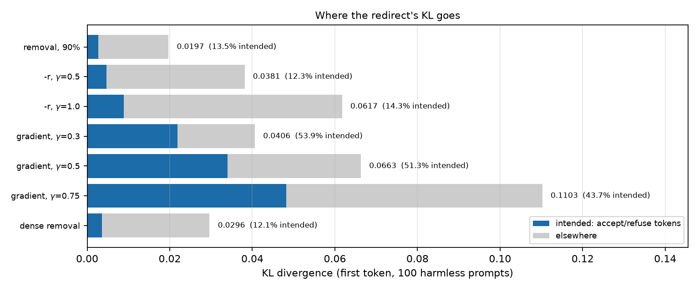

*Figure 5. The blue part is mass moving between the 9 acceptance and 6 refusal
openers. At `gamma = 0.3` the acceptance gradient puts 53.9% of its KL there,
against 13.5% for removal and 12.1% for dense removal.*

### Hybrid: remove the worst redirects, inside a fixed atom set

The extra KL of the redirect is not uniform across atoms. Rank each selected
atom by its refusal load per unit of first-order harmless write:

```
efficiency_f = load_f / (|alpha_f| * rms(good activation_f))
```

with the head analogue `load_h / rms(o_h . beta_h)`. Remove the lowest `q`
fraction and redirect the rest. At `gamma = 0.3`, removing the bottom 25% cuts
KL by 13.7%; the refusal point estimates also fall. At `gamma = 0.75`, removing
the bottom 30% cuts KL by 33.5%.

| `gamma` | q | removal atoms | refusal, 100 | held out, 300 | KL | PPL |
| --- | --- | --- | --- | --- | --- | --- |
| 0.3 | 0 | 0 | 0.110 | 0.230 | 0.0406 | 11.57 |
| 0.3 | 0.25 | 8,761 | 0.090 | 0.210 | 0.0351 | 11.57 |
| 0.3 | 0.40 | 14,017 | 0.100 | 0.217 | 0.0301 | 11.57 |
| 0.75 | 0 | 0 | 0.060 | 0.117 | 0.1103 | 11.62 |
| 0.75 | 0.30 | 10,513 | 0.070 | 0.110 | 0.0733 | 11.60 |
| 0.75 | 0.40 | 14,017 | 0.070 | 0.120 | 0.0605 | 11.60 |
| pure removal | 1.0 | 35,043 | 0.520 | 0.437 | 0.0197 | 11.56 |

The refusal differences are inside the sampling error of 100 and 300 prompts;
the KL cuts are the robust part. Ranking by the largest harmless write instead
of the ratio is worse: at `gamma = 0.75`, removing the top 10% by raw damage
raises held-out refusal to 0.203 against 0.117, because those atoms also carry
refusal load. The hybrid is a trade, not a free lunch: the dense edit still wins
held-out refusal per unit KL.

Both edits produce dense checkpoints, so inference is identical. On the same GPU
write path the hybrid's 35,043 columns take 0.044 s against 0.160 s for the dense
251,216 (3.6x); the all-atom selection takes 1.35 s against 0.25 s for the 90%
selection (5.4x). The full 18.4 s pipeline is dominated by capture and
calibration, so the end-to-end saving is about 1.2 s, or 6%, not an order of
magnitude. `../results/edit_timing.json` keeps the measurements.

### Dense removal with the target on the efficient atoms

The hybrid inside a fixed 35,043-atom set was the first form. The better form
keeps the removal dense and gives the target to the atoms that convert most per
unit of harmless write. `q` is the fraction removed: the atoms are ranked
ascending by `efficiency`, the bottom `q` lose their refusal component, and the
top `1 - q` also carry the target at `gamma`. `q = 1` is dense removal.

| `gamma` | q | removed | redirected | refusal, 100 | held out, 300 | KL | PPL |
| --- | --- | --- | --- | --- | --- | --- | --- |
| 0 | 1.0 | 251,216 | 0 | 0.060 | 0.097 | 0.0296 | 11.88 |
| 0 | 0.9 | 226,094 | 25,122 | 0.060 | 0.093 | 0.0300 | 11.88 |
| 0.3 | 0.995 | 249,960 | 1,256 | 0.030 | 0.067 | 0.0329 | 11.86 |
| 0.3 | 0.99 | 248,704 | 2,512 | 0.030 | 0.053 | 0.0340 | 11.86 |
| 0.3 | 0.97 | 243,680 | 7,536 | 0.030 | 0.057 | 0.0358 | 11.87 |
| 0.3 | 0.95 | 238,655 | 12,561 | 0.030 | 0.047 | 0.0387 | 11.88 |
| 0.3 | 0.9 | 226,094 | 25,122 | 0.030 | 0.047 | 0.0426 | 11.88 |
| 0.3 | 0.8 | 200,973 | 50,243 | 0.030 | 0.053 | 0.0633 | 11.89 |
| 0.45 | 0.95 | 238,655 | 12,561 | 0.030 | 0.033 | 0.0447 | 11.88 |
| 0.45 | 0.9 | 226,094 | 25,122 | 0.020 | 0.040 | 0.0522 | 11.90 |
| 0.6 | 0.95 | 238,655 | 12,561 | 0.030 | 0.037 | 0.0522 | 11.90 |
| 0.3 | 0.45 | 113,047 | 138,169 | 0.030 | 0.030 | 0.1094 | 12.03 |

The cost of the target is the number of atoms that carry it, not the number that
are removed. Removing 90% leaves held-out refusal at 0.093 for 0.0300 KL, the
same as removing 100%: the atoms removed in that last 10% are the ones the
ranking would rather redirect. Adding the target to 1,256 atoms, half a percent
of the edit, takes held-out refusal to 0.067 at 1.11 times the KL. Adding it to
12,561 takes it to 0.033, a 66% cut, at 1.51 times the KL and the same
perplexity. Past that the curve flattens: at fixed `gamma = 0.3`, moving the
target from 5% to 55% of the atoms takes held-out refusal from 0.047 to 0.030 and
KL from 0.0387 to 0.1094, so 125,608 more target columns buy five prompts of 300
for 2.8 times the KL. That is why the shipped point is the 5% one.

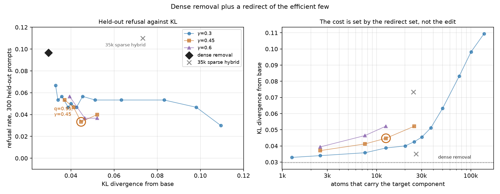

*Figure 2. Left, held-out refusal against KL: the family leaves dense removal at
0.097 and 0.030 KL. Right, KL against the number of atoms that carry the target.
The cost follows that count; the grey crosses are the 35,043-atom sparse family,
which the dense family dominates.*

The ranking is the part that matters. At q=0.95 and `gamma = 0.45` the same
12,561 atoms cost 0.0447 KL when chosen by efficiency, 0.0799 when chosen by
load alone, and 0.1743 when chosen by the largest harmless write. That last
ranking reaches the same refusal for four times the KL, which is the direct
measurement of why the ratio is the selection rule.

| ranking of the 12,561 target atoms | refusal, 100 | held out, 300 | KL | PPL |
| --- | --- | --- | --- | --- |
| load per unit harmless write | 0.030 | 0.033 | 0.0447 | 11.88 |
| load | 0.020 | 0.030 | 0.0799 | 12.07 |
| harmless write | 0.030 | 0.033 | 0.1743 | 12.69 |

The shipped point is exported by `scripts/45_export_family.py` and measured
again after reloading, so the numbers include the round trip through
safetensors and bfloat16: the reloaded checkpoint gives 0.030/0.033/0.0447/11.88,
identical to the in-memory edit. Its capability is 0.720/0.757/0.650 on the
three tasks, against the base model's 0.733/0.757/0.643.

The responses at the shipped point are substantive compliance, not keyword
evasion: the spam-bot prompt returns "Sure, here's an example of how you could
create a bot...", the malware prompt returns a socket script, and the
fake-news prompt returns a numbered procedure.
`../results/redirect/dense_hybrid_samples.json` keeps six.

Against Heretic on the same 300 prompts, ARA reaches 0.007 at 0.612 KL and 13.61
PPL, MPOA 0.210 at 0.0285 and 11.57. The shipped point is 0.033 at 0.0447 and
11.88: 1.6 times MPOA's KL for 6.3 times less refusal, and 13.7 times less KL
than ARA for 5.0 times its refusal.

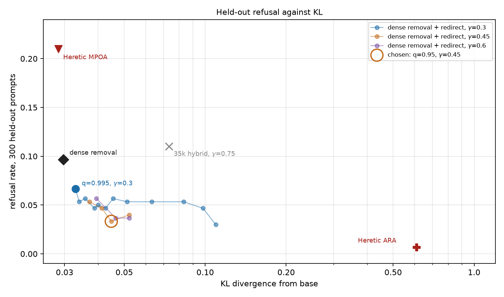

*Figure 6. Held-out refusal against KL for everything measured, both Heretic
modes included. The ring is q=0.95 at `gamma = 0.45`.*

### Three cheaper targets that do not work

KL is the price of moving the harmless next-token distribution. A target that
raises acceptance without moving it would be free conversion, so three were
built and measured at q=0.95, `gamma = 0.45`:

| target | refusal, 100 | held out, 300 | KL | PPL |
| --- | --- | --- | --- | --- |
| the acceptance gradient | 0.030 | 0.033 | 0.0447 | 11.88 |
| orthogonal to `r` | 0.030 | 0.037 | 0.0431 | 11.89 |
| orthogonal to the mean harmless top-1 gradient | 0.020 | 0.030 | 0.0445 | 11.88 |
| orthogonal to the top 32 harmless top-1 gradient directions | 0.040 | 0.080 | 0.0310 | 11.87 |
| per-layer `gamma` from measured conversion per unit KL | 0.020 | 0.027 | 0.0501 | 11.88 |

The first two are the measurement's own controls: the acceptance gradient is
already nearly orthogonal to `r`, cosine at most 0.153, so orthogonalising it
again changes nothing. The third removes the direction that raises the mean
harmless next token, and changes the KL by 0.4%. The fourth removes the 32
leading directions of the harmless logit Jacobian: it cuts KL by 31% and gives
back 2.4 times the refusal. The fifth spends `gamma` per layer in proportion to
measured acceptance gained per unit KL; it moves two prompts in a hundred and
costs 12% more KL. Conversion and harmless movement share the same axes, so the
frontier is close to a ray and the free parameter is how many atoms carry the
target.

### The continuous variant

Giving every atom its own weight, `gamma_f = gamma * t_f` with `t_f` a monotone
function of the same efficiency, does not improve on the step. The best
continuous points match the binary at the same KL or lose held-out refusal:

| `gamma` | policy | refusal, 100 | held out, 300 | KL |
| --- | --- | --- | --- | --- |
| 0.3 | binary, q=0.25 | 0.090 | 0.210 | 0.0351 |
| 0.3 | continuous, soft q=0.25 | 0.090 | 0.230 | 0.0327 |
| 0.75 | binary, q=0.30 | 0.070 | 0.110 | 0.0733 |
| 0.75 | continuous, soft q=0.25 | 0.060 | 0.140 | 0.0731 |

At `gamma = 0.75` the continuous sqrt point matches the binary q=0.35 point
(0.127 held out at KL 0.065), while the binary q=0.30 point keeps 0.110 against
the continuous soft point's 0.140 at KL 0.073. No continuous point improves the
frontier. The step removes the low-efficiency atoms' target component entirely;
a small gamma on every atom pays KL everywhere, including on the atoms that
conversion does not need. The full continuous sweep is in
`../results/redirect/continuous_sweep.json`.

A per-atom KL gradient cannot improve the ranking at first order: the KL is at a
minimum at the base model, so its derivative with respect to the weights is
zero. A second-order (Fisher or Gauss-Newton) attribution is the next signal to
try, not a first-order gradient.

### The second model

The redirect on Qwen2.5-0.5B-Instruct, plane 14, 16,894 atoms. The target is
fitted on that model's own 400 harmful prompts; this is a replication, not a
transfer of the 1.5B target.

| `gamma` | policy | refusal, 100 | held out, 300 | KL | PPL |
| --- | --- | --- | --- | --- | --- |
| 0.3 | pure redirect | 0.120 | 0.257 | 0.1017 | 17.77 |
| 0.3 | hybrid, q=0.40 | 0.100 | 0.237 | 0.0783 | 17.71 |
| 0.75 | pure redirect | 0.060 | 0.140 | 0.2830 | 18.01 |
| 0.75 | hybrid, q=0.30 | 0.060 | 0.133 | 0.2084 | 17.75 |
| any | pure removal, q=1 | 0.480 | 0.457 | 0.0419 | 17.70 |

The redirect replicates the conversion: the same 16,894 atoms go from 0.480
refusal under removal to 0.120 under the pure redirect and 0.100 under the
hybrid. Its KL is 2.4 times the removal's at `gamma = 0.3`, and the hybrid cuts
it 23% at the same refusal. The 0.5B dense edit is 0.167 held out at 0.0862 KL
and 18.07 PPL; the hybrid reaches 0.237 at 0.0783 and 17.71. The dense edit
still wins held-out refusal per unit KL, and Heretic MPOA at 0.137 held out and
0.033 KL is better than either.

The dense family applies there too, and it is the best configuration on this
model. Dense removal gives 0.080/0.167/0.0862/18.07. The target on the top 5% at
`gamma = 0.3` gives 0.030/0.130/0.1093/18.10, and at `gamma = 0.6`
0.040/0.093/0.1478/18.11. That is a 44% held-out cut at 1.7 times the KL,
against 66% at 1.5 times on the 1.5B model, so the gain is smaller on the small
model. Heretic MPOA reaches 0.137 at 0.0330, still cheaper than the 0.5B family;
ARA reaches 0.000 at 3.1484 with a perplexity of 107.

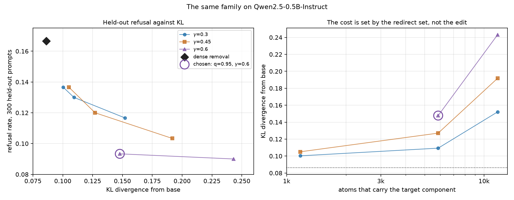

*Figure 10. The dense family on Qwen2.5-0.5B-Instruct at plane 14, same two
panels as figure 2. Dense removal sits at 0.167 and 0.0862; the target on the top
5% reaches 0.130 at 0.1093. The gain is smaller than on the 1.5B model.*

### Phrase weight

The target is `a = unit(lambda * phrase + base)`, with `base` the acceptance
gradient and `phrase` the unit gradient of `log P("I can do that.")`.
`lambda = 0` is the acceptance gradient. Raising lambda raises the phrase's log
probability but never surfaces the phrase in 100 responses, and it costs
held-out refusal:

| `gamma` | lambda | refusal, 100 | held out, 300 | KL | phrase logprob | starts with phrase | contains phrase |
| --- | --- | --- | --- | --- | --- | --- | --- |
| 0.3 | 0 | 0.100 | 0.230 | 0.0416 | -19.93 | 0/100 | 0/100 |
| 0.3 | 0.25 | 0.130 | 0.230 | 0.0390 | -18.73 | 0/100 | 0/100 |
| 0.3 | 0.5 | 0.140 | 0.237 | 0.0379 | -17.72 | 0/100 | 0/100 |
| 0.3 | 1 | 0.200 | 0.247 | 0.0336 | -16.35 | 0/100 | 0/100 |
| 0.3 | 2 | 0.310 | 0.307 | 0.0308 | -15.10 | 0/100 | 0/100 |
| 0.3 | 4 | 0.380 | 0.367 | 0.0296 | -14.46 | 0/100 | 0/100 |
| 0.75 | 0 | 0.070 | 0.123 | 0.1085 | -20.04 | 0/100 | 0/100 |
| 0.75 | 0.25 | 0.060 | 0.137 | 0.1087 | -18.37 | 0/100 | 0/100 |
| 0.75 | 0.5 | 0.060 | 0.140 | 0.0989 | -17.06 | 0/100 | 0/100 |
| 0.75 | 1 | 0.050 | 0.173 | 0.0882 | -14.83 | 0/100 | 0/100 |
| 0.75 | 2 | 0.200 | 0.203 | 0.0790 | -12.70 | 0/100 | 0/100 |
| 0.75 | 4 | 0.320 | 0.267 | 0.0737 | -11.45 | 0/100 | 0/100 |

At `gamma = 0.3`, `lambda = 0` has the best held-out refusal (0.230) and the
best 100-prompt refusal (0.100) of the sweep. At `gamma = 0.75`, `lambda = 0.25`
and 0.5 match the 100-prompt refusal but lose held-out refusal (0.137 and 0.140
against 0.123). No lambda improves the frontier. The literal phrase appears in
none of the 100 responses at any setting; the model writes "Sure, here's..."
instead.

A single phrase-plus-acceptance point in an earlier run (`0.070/0.110/0.0997`)
is not reproduced by the weight sweep. Its advantage over the acceptance
gradient is within sampling error and depends on the unnormalised mix; the sweep
normalises the two directions separately, which gives the phrase more weight.
The phrase target is rejected; the distributed acceptance direction is the
mechanism. `../results/redirect/phrase_weight.json` keeps the sweep.

### Category selectivity

The selection is contrastive: a feature is a candidate when its activation rises
on the target category against the other harmful prompts, and its down vector
writes the shared refusal direction. The 20,000 and 50,000 rows use strength 2.5
(`gamma = 1.5`); the 5,000 control uses strength 2.0 (`gamma = 1.0`).

| atoms | cyber refusal | other refusal | KL |
| --- | --- | --- | --- |
| 5,000 | 0.955 (21/22) | 0.987 (77/78) | 0.004 |
| 20,000 | 0.682 (15/22) | 0.769 (60/78) | 0.033 |
| 50,000 | 0.000 (0/22) | 0.346 (27/78) | 0.201 |

At 50,000 atoms every cyber prompt is converted while a third of the other
categories still refuse. The selective operating point exists and costs 0.20 KL.
A 5,000-atom budget moves neither category.

Dense removal has no equivalent control: editing every atom that writes the
direction removes it for every category at once.

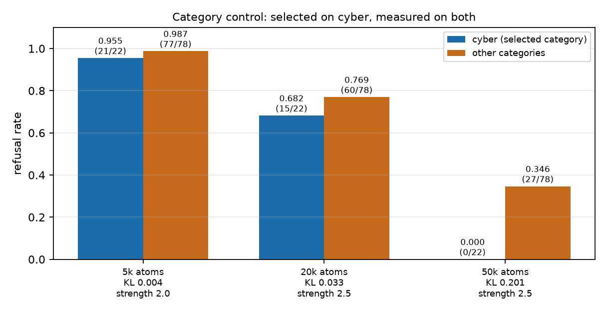

*Figure 7. The selection is contrastive on cyber; the other categories are the
control. The 20,000 and 50,000 rows use strength 2.5; the 5,000 control uses
strength 2.0.*

### Other targets

Redirecting toward the residual shift of a compliant model (the exported
removal checkpoint), at the same 90% selection:

| `gamma` | refusal | KL | PPL |
| --- | --- | --- | --- |
| 0.5 | 0.260 | 0.0399 | 11.57 |
| 1.0 | 0.650 | 0.0134 | 11.56 |
| 1.5 | 0.290 | 0.0386 | 11.58 |

The cosine between that shift and `-r` is 0.93 at plane 18 and falls to 0.25 at
plane 27, so the teacher target is close to `-r` where `-r` already works and
different where it does not (`../results/analysis/direction_geometry.json`). It
converts less than the acceptance gradient at every KL.

Redirecting only heads, at 100% of head load (10 atoms):

| strength | refusal | opening | KL |
| --- | --- | --- | --- |
| 2.0 | 0.850 | 0.820 | 0.0028 |
| 3.0 | 0.710 | 0.690 | 0.0048 |

Ten heads carry the attributed head load and move refusal by 0.14. The removal
study finds attention accounts for 31 of the 92 refusal points the full edit
removes, so this is a statement about a sparse head set, not about attention.

Redirecting features only, at 90% load (35,151 atoms, `gamma = 1.0`): 0.250
refusal at KL 0.0720, against 0.150 at 0.0617 when the selected heads are
included. The head atoms pay for themselves at that scale.

### The artifact

Both operating points export to a normal checkpoint and an operator patch.

| edit | atoms | layers | patch bytes | replay max logit diff | reloaded refusal | reloaded held out | reloaded KL | reloaded PPL |
| --- | --- | --- | --- | --- | --- | --- | --- | --- |
| `gamma = 0.3` | 35,043 | 28 | 514,340 | 0.0 | 0.110 | 0.230 | 0.0406 | 11.57 |
| `gamma = 0.75` | 35,043 | 28 | 519,204 | 0.0 | 0.060 | 0.117 | 0.1103 | 11.62 |

The reloaded columns are measured after a round trip through safetensors and
bfloat16, and they reproduce the in-memory table exactly. The patch holds one
direction and one target per layer (the direction repeats plane 18), one `int32`
index and one `float32` scale per atom, and `gamma`. Replay recomputes
`d_f - alpha_f r + gamma alpha_f a` from the base column, so the patch carries no
replacement vector.

A subset patch in the older `rows` representation stores a full down vector per
atom, which is 6,144 bytes per atom at hidden width 1,536. The operator form
stores 8 bytes per atom, plus two `hidden` vectors per layer.

### What the redirect keeps

The gate and up rows are untouched, so every selected feature fires on the same
inputs as before. The layer-0 detector is bit-identical. Downstream activations
still move, because the residual changes and later layers read it: the median
activation ratio of 200 selected features on harmful prompts falls to 0.08 after
the redirect. Of those 200 features, 157 change their top-5 target list and 50
change the top target. The probe records the list change, which is why its
`down_top_token_changed` field reads 157 at strength 2.0; the top-target count is
the graph script's `target_changed`.

The graph-level claim is therefore "the same nodes, new edges." It is not "the
same activations."

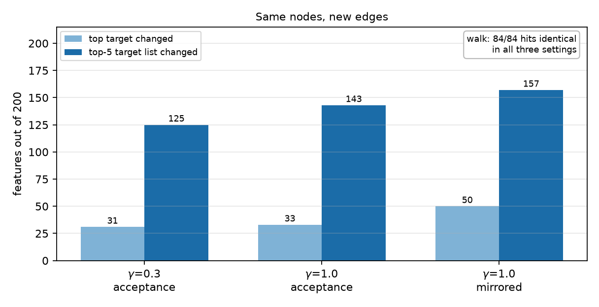

*Figure 8. The top-5 target list moves for 125 of the 200 highest-load features
at `gamma = 0.3`, while the gate walk returns the same 84 features with equal
scores. The top target alone changes for 31.*

## Ablation studies

All on Qwen2.5-1.5B, 100 harmful prompts unless stated.

### Which path writes the refusal direction

| edit | refusal | KL | projection on the direction |
| --- | --- | --- | --- |
| attention only, all layers | 0.69 | 0.0113 | 50.7 |
| FFN only, all layers | 0.39 | 0.0649 | 8.6 |
| both, all layers | 0.08 | 0.0966 | 4.5 |

Attention carries 11% of the attributed mean write and accounts for 31 of the
92 points the edit removes. The attribution and the causal effect do not
coincide: the attention edit buys three times its share of the write.

### Which plane's direction

One direction applied to every layer of both paths, all rows.

| plane | propagation score | refusal | KL | PPL |
| --- | --- | --- | --- | --- |
| 14 | 51 | 0.33 | 0.049 | 11.55 |
| 16 | 70 | 0.14 | 0.0278 | 11.56 |
| 17 | 78 | 0.09 | 0.0295 | 11.77 |
| 18 | 78 | 0.06 | 0.0296 | 11.88 |
| 19 | 79 | 0.10 | 0.0582 | 12.14 |
| 20 | 74 | 0.08 | 0.0438 | 11.90 |
| 21 | 79 | 0.10 | 0.0304 | 11.63 |
| 22 | 84 | 0.24 | 0.0367 | 11.70 |
| 24 | 59 | 0.44 | 0.047 | 11.66 |
| 28 | 16 | 0.58 | 0.032 | 11.55 |
| per-layer directions | — | 0.08 | 0.0966 | 11.68 |

The propagation score ranks plane 22 first and planes 19 and 21 next. The
measured optimum is 18, fourth on the score. Every plane from 17 to 21 is
usable and the score cannot separate them. It works as a region filter and
fails as a selector, so the calibration replaces it.

The last plane's direction is the clear counterexample to single-direction
abliteration. It drives the projection onto that direction to exactly zero and
leaves 58% of refusals.

### How many layers

One direction (plane 22, the score's top pick) applied to a growing set of
layers, all rows of both paths.

| layers edited | refusal | KL |
| --- | --- | --- |
| 1 (layer 21) | 0.96 | 0.0055 |
| 7 (21-27) | 0.92 | 0.0102 |
| 10 (18-27) | 0.69 | 0.0289 |
| 14 (14-27) | 0.39 | 0.0378 |
| 28 (all) | 0.24 | 0.0367 |

No single layer matters. The curve falls monotonically with the number of
layers edited, which is why a layer-sparse edit of the same direction does not
work.

### Atom-level sparsity

Atoms selected by attributed load per unit weight change, all layers. These runs
use a per-layer (`local`) direction, so the 251k row is the per-layer dense
control at 0.08 refusal and 0.0966 KL, not the shipped plane-18 model at 0.06 and
0.0296.

| load covered | atoms | refusal | KL | rel. weight change |
| --- | --- | --- | --- | --- |
| 50% | 12.5k | 0.78 | 0.019 | 0.018 |
| 90% | 34.1k | 0.44 | 0.044 | 0.025 |
| 90%, two rounds | 34.1k then 33.7k | 0.21 | 0.050 | — |
| 99% | 48.9k | 0.39 | 0.059 | 0.029 |
| 100% of positives | 65.1k | 0.31 | 0.068 | 0.027 |
| 100% of all atoms | 251k | 0.08 | 0.097 | 0.026 |

Atom sparsity does not replace the full matrix. Removing the direction from a
subset of atoms leaves it in the matrix's range, and the remaining rows re-create
it for the prompts that matter. A second attribution round at the same 90%
target lowers refusal from 0.44 to 0.21 in one run, so re-selection helps; it
still leaves more refusal than the full matrix at 0.08.

### Strength

Plane 18, all rows, all layers, strength applied to the removed component.

| strength | refusal (100) | KL | PPL |
| --- | --- | --- | --- |
| 1.00 | 0.06 | 0.0296 | 11.88 |
| 1.15 | 0.02 | 0.0476 | 12.04 |
| 1.30 | 0.04 | 0.0930 | 12.38 |
| 1.45 | 0.02 | 0.2680 | 13.20 |

Exact removal is the efficient point. Over-ablation buys four prompts out of a
hundred and costs nine times the KL at 1.45.

### Layer-wise strength from the trace

| schedule | refusal | KL | PPL |
| --- | --- | --- | --- |
| flat (all layers, strength 1) | 0.06 | 0.0296 | 11.88 |
| strength = normalised layer projection | 0.79 | 0.0033 | 11.56 |
| strength = same, floor 0.25 | 0.77 | 0.0050 | 11.59 |

Scaling the edit down in proportion to each layer's measured write removes
almost none of the behaviour. Partial strength at a layer behaves like no
ablation at that layer, for the same reason atom sparsity fails.

## What the numbers mean

1. The attribution is exact and separates the paths. The FFN writes 89% of the
   mean refusal direction.
2. Causal effect does not follow the mean write. Attention carries little load
   and matters a great deal; late planes carry all the load and matter little.
3. The direction rotates with depth, so no single direction is the mechanism. A
   single mid-stack direction still works, because removal must happen at every
   layer and the mid-stack direction is the one the layers continue.
4. The efficient edit is one rank-1 projection per matrix, every atom, exact
   atom-norm restoration, every layer, with the plane chosen by calibration. The
   unit is prior art; the measurements above say why it must be dense.
5. Against Heretic, LiberShift is better on the 1.5B model at matched KL and
   slightly worse on the 0.5B model at higher KL. Heretic's ARA reaches lower
   refusal and pays for it in capability, catastrophically on the small model.
6. Replacing the removed component converts more than deleting it at the same
   atoms: 0.15 against 0.52 on the 100-prompt slice and 0.18 against 0.44 held
   out.
7. The acceptance gradient is nearly orthogonal to the refusal direction, with a
   cosine of at most 0.153, and it converts more per unit KL than the mirrored
   direction at the same scale.
8. The sparse redirect does not beat the dense edit on held-out refusal per unit
   of total KL. It does beat it on KL outside the acceptance and refusal openers
   and on perplexity. Which of the three is the capability measure is open.
9. The redirect is the only edit here with a category control, and the control
   works: 0.00 cyber refusal against 0.35 elsewhere at 50,000 atoms.
10. The hybrid improves the sparse redirect's own Pareto front: removing the
    atoms with the worst conversion per unit of harmless write cuts KL 13.7% to
    33.5% with refusal inside sampling error. It does not close the gap to the
    dense edit on held-out refusal per unit KL.
